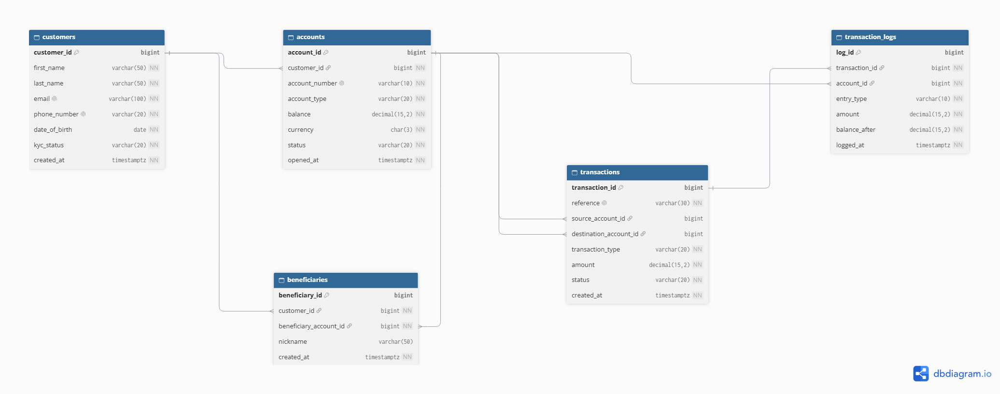
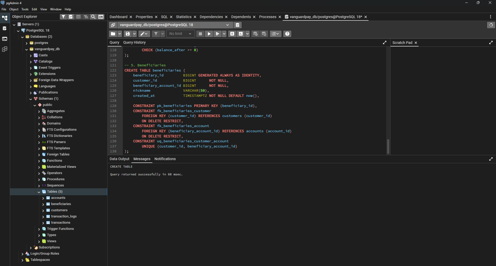
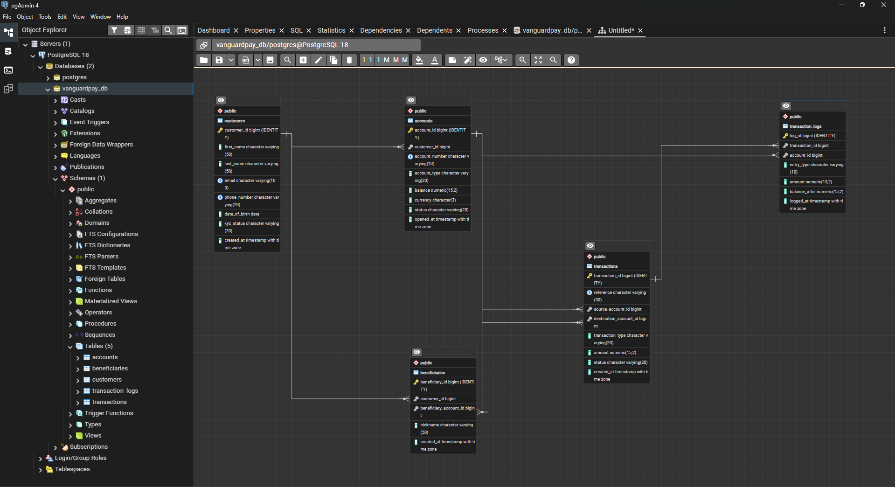
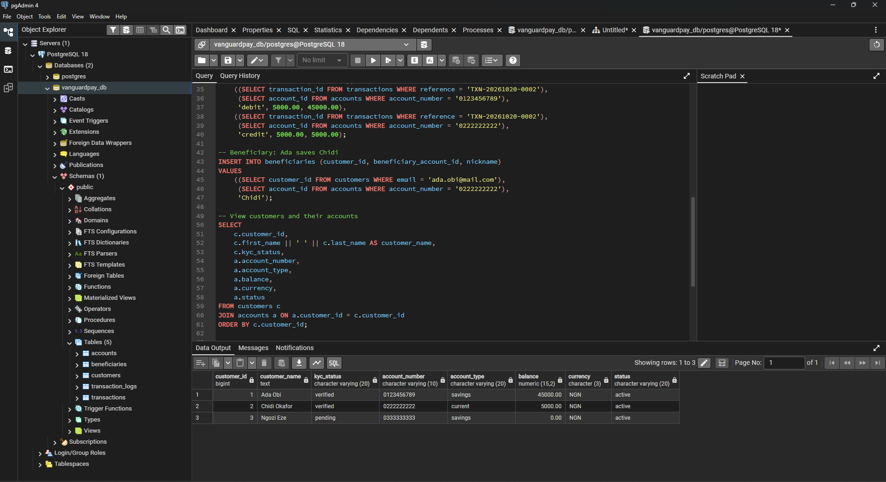
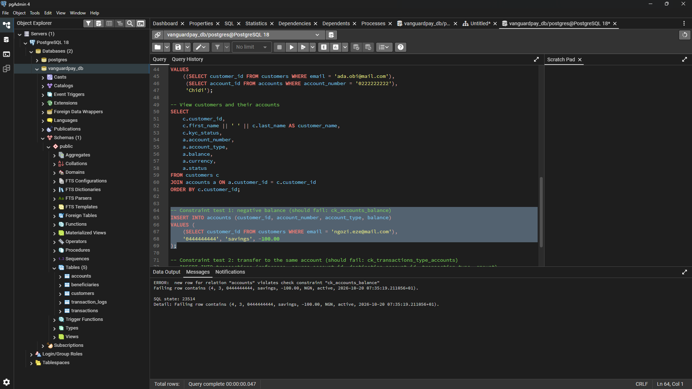
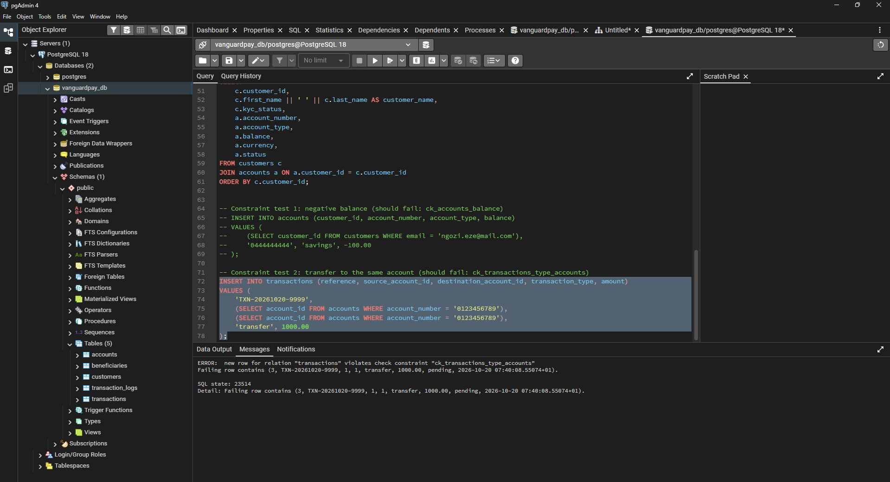

# Portfolio 1: Database Design and Modelling

This folder covers the relational design for the VanguardPay case study. It contains the case study description, the ER diagram, the relational schema, keys, constraints, and the normalisation explanation. The database is built in PostgreSQL and managed with pgAdmin 4.

---

## Selected Case Study: VanguardPay

### Organisation

VanguardPay is a simulated fintech company based in Nigeria. 

### Nature of the Business / System

VanguardPay is a digital banking and payments platform. Customers sign up through a mobile app or website, open accounts, and move money without visiting a physical branch. The platform lets customers hold balances, send money to other accounts, deposit and withdraw funds, and view their transaction history. Because VanguardPay handles real money, the database must be accurate, secure, and fully auditable. Every naira that moves must be recorded and traceable.

### Users of the Database

- **Customers:** use the app to check balances, make transfers, and view statements.
- **Customer support agents:** look up customer accounts and transactions to resolve complaints.
- **Compliance and audit officers:** review transaction logs and check that account balances are correct.
- **Fraud analysts:** monitor transactions and audit logs for suspicious behaviour.
- **Database administrators:** manage the database, backups, performance, and access control.
- **The VanguardPay application backend:** reads and writes data automatically on behalf of customers.

### Major Data to be Stored

- **Customers:** personal details, contact information, and identity verification (KYC) status.
- **Accounts:** account numbers, account types (e.g. savings, current), balances, currency, and account status.
- **Transactions:** transfers, deposits, and withdrawals, with amounts, timestamps, and status (pending, successful, failed, reversed).
- **Transaction logs:** a permanent audit record of every change to money in the system.
- **Beneficiaries:** saved recipients that customers send money to often.

### Key Operations the Database Will Support

1. **Register a customer and open an account.**
2. **Deposit funds** into an account.
3. **Withdraw funds** from an account, blocking the request if the balance is too low.
4. **Transfer funds** between two accounts safely, so that money is never lost or duplicated.
5. **Reverse failed transactions** and put the money back correctly.
6. **Audit account balances** by comparing stored balances against the transaction history.
7. **Generate account statements** for a chosen customer and date range.
8. **Identify suspicious activity** by querying transactions, such as unusually large or very frequent transfers.

---

## ER Diagram, Relational Schema, Keys, and Constraints

### ER Diagram

I designed the VanguardPay database with 5 tables. The ER diagram below shows how they connect. I drew it in dbdiagram.io.

### Business Rules and Relationships

| Relationship | Cardinality | Explanation |
|---|---|---|
| `customers` → `accounts` | One-to-many | One customer can own many accounts. Each account belongs to one customer. |
| `customers` → `beneficiaries` | One-to-many | One customer can save many recipients. |
| `accounts` → `beneficiaries` | One-to-many | One account can be saved as a recipient by many customers. |
| `accounts` → `transactions` (source) | One-to-many | One account can send money in many transactions. |
| `accounts` → `transactions` (destination) | One-to-many | One account can receive money in many transactions. |
| `transactions` → `transaction_logs` | One-to-many | One transaction creates one or more log entries. A transfer creates two (a debit and a credit). |
| `accounts` → `transaction_logs` | One-to-many | One account can have many log entries, which I use to audit its balance. |

Deposits have no source account and withdrawals have no destination account, so those two columns in `transactions` are allowed to be empty depending on the transaction type.

### Relational Schema

Primary keys are underlined with `PK` and foreign keys are marked `FK`.

- **customers** (customer_id `PK`, first_name, last_name, email, phone_number, date_of_birth, kyc_status, created_at)
- **accounts** (account_id `PK`, customer_id `FK`, account_number, account_type, balance, currency, status, opened_at)
- **transactions** (transaction_id `PK`, reference, source_account_id `FK`, destination_account_id `FK`, transaction_type, amount, status, created_at)
- **transaction_logs** (log_id `PK`, transaction_id `FK`, account_id `FK`, entry_type, amount, balance_after, logged_at)
- **beneficiaries** (beneficiary_id `PK`, customer_id `FK`, beneficiary_account_id `FK`, nickname, created_at)

### Keys

| Table | Primary Key | Foreign Keys | Unique Keys |
|---|---|---|---|
| `customers` | `customer_id` | None | `email`, `phone_number` |
| `accounts` | `account_id` | `customer_id` → `customers` | `account_number` |
| `transactions` | `transaction_id` | `source_account_id` → `accounts`, `destination_account_id` → `accounts` | `reference` |
| `transaction_logs` | `log_id` | `transaction_id` → `transactions`, `account_id` → `accounts` | None |
| `beneficiaries` | `beneficiary_id` | `customer_id` → `customers`, `beneficiary_account_id` → `accounts` | (`customer_id`, `beneficiary_account_id`) together |

All foreign keys use `ON DELETE RESTRICT`. This means a customer or account cannot be deleted while other records still depend on it. I chose this because financial records should never disappear.

### Data Integrity and Business Rule Constraints

| Table | Constraint | Purpose |
|---|---|---|
| `customers` | `kyc_status` must be `pending`, `verified`, or `rejected` | Only valid identity statuses are allowed. |
| `customers` | `email` and `phone_number` must be unique | No two customers can share contact details. |
| `accounts` | `balance >= 0` | An account balance can never go negative. |
| `accounts` | `account_type` must be `savings` or `current` | Only valid account types are allowed. |
| `accounts` | `status` must be `active`, `frozen`, or `closed` | Only valid account statuses are allowed. |
| `accounts` | `account_number` must be exactly 10 digits | Keeps account numbers in a valid format. |
| `transactions` | `amount > 0` | A transaction cannot be zero or negative. |
| `transactions` | `transaction_type` must be `deposit`, `withdrawal`, or `transfer` | Only valid transaction types are allowed. |
| `transactions` | `status` must be `pending`, `successful`, `failed`, or `reversed` | Only valid statuses are allowed. |
| `transactions` | Deposit needs a destination only, withdrawal needs a source only, transfer needs both and they must be different | Stops a transaction from having the wrong accounts for its type. |
| `transaction_logs` | `entry_type` must be `debit` or `credit` | Every log entry must be one or the other. |
| `transaction_logs` | `amount > 0` and `balance_after >= 0` | Log entries must show valid money values. |
| All tables | `NOT NULL` on required columns | Important fields can never be left empty. |

---

## Normalisation

Normalisation means organising tables so that each fact is stored in only one place. I started from one messy table that holds everything about VanguardPay and broke it down step by step into my final 5 tables.

### Step 0: Unnormalised Table (UNF)

This is what the data looks like if I put everything into one table. Customer details, account details, transactions, log entries, and beneficiaries are all crammed together, with several values in one cell.

| customer_id | customer_name | email | account_numbers | account_types | balances | transaction_refs | transaction_amounts | log_entries | beneficiaries |
|---|---|---|---|---|---|---|---|---|---|
| C001 | Ada Obi | ada@mail.com | 0123456789, 0123456790 | savings, current | 45000.00, 12000.00 | TXN001, TXN002 | 5000.00, 20000.00 | debit, credit | 0222222222 (Chidi) |

This design causes three problems (anomalies):

- **Update anomaly:** If Ada changes her email, I have to find and change it everywhere it appears. Miss one and the data disagrees with itself.
- **Insertion anomaly:** I cannot add a new customer who has no account or transaction yet, because the table expects those values to exist.
- **Deletion anomaly:** If I delete Ada's only transaction, I may also lose her customer and account details.

### Step 1: First Normal Form (1NF)

**Rule:** every cell holds one value, there are no repeating groups, and every row has a primary key.

To fix this, I did two things:

1. I split every list into separate rows, so there is one row per log entry.
2. Beneficiaries are a separate repeating group that has nothing to do with transactions. If I kept them in the same table, every beneficiary would be copied onto every transaction row. So I moved them into their own table straight away.

**Table A: customer, account, transaction, and log data** (primary key: `transaction_reference` + `account_number`). The table below shows a few sample rows.

| customer_id | first_name | email | kyc_status | account_number | account_type | balance | transaction_reference | transaction_type | amount | transaction_status | source_account | destination_account | entry_type | balance_after |
|---|---|---|---|---|---|---|---|---|---|---|---|---|---|---|
| C001 | Ada | ada@mail.com | verified | 0123456789 | savings | 45000.00 | TXN001 | transfer | 5000.00 | successful | 0123456789 | 0222222222 | debit | 45000.00 |
| C002 | Chidi | chidi@mail.com | verified | 0222222222 | current | 15000.00 | TXN001 | transfer | 5000.00 | successful | 0123456789 | 0222222222 | credit | 15000.00 |
| C001 | Ada | ada@mail.com | verified | 0123456789 | savings | 45000.00 | TXN002 | deposit | 20000.00 | successful | *(empty)* | 0123456789 | credit | 50000.00 |

**Table B: beneficiaries** (primary key: `beneficiary_id`)

| beneficiary_id | customer_id | beneficiary_account_number | nickname |
|---|---|---|---|
| 1 | C001 | 0222222222 | Chidi |

Table A is now in 1NF, but Ada's name, email, and account details are repeated on every row. That is the problem 2NF fixes.

### Step 2: Second Normal Form (2NF)

**Rule:** no non-key column may depend on only *part* of a composite primary key.

Table A has a composite key (`transaction_reference` + `account_number`). Checking each column:

| Columns | Depend on | Problem |
|---|---|---|
| `transaction_type`, `amount`, `transaction_status`, `source_account`, `destination_account` | `transaction_reference` only | Partial dependency |
| `account_type`, `balance`, `customer_id`, `first_name`, `email`, `kyc_status` | `account_number` only | Partial dependency |
| `entry_type`, `balance_after` | The full key (`transaction_reference` + `account_number`) | None |

So I split Table A into three tables:

- **transactions** (transaction_reference, transaction_type, amount, status, source_account, destination_account)
- **accounts** (account_number, account_type, balance, customer_id, first_name, email, kyc_status)
- **transaction_logs** (transaction_reference, account_number, entry_type, balance_after)

Now a transaction is stored once instead of once per log entry. But the `accounts` table still has a problem: `first_name`, `email`, and `kyc_status` describe the customer, not the account.

### Step 3: Third Normal Form (3NF)

**Rule:** no non-key column may depend on another non-key column (no transitive dependency).

In `accounts`, the chain is `account_number` → `customer_id` → `first_name`, `email`, `kyc_status`. The customer details depend on `customer_id`, not on the account. So I moved them into their own table:

- **customers** (customer_id, first_name, last_name, email, phone_number, date_of_birth, kyc_status, created_at)
- **accounts** (account_number, account_type, balance, currency, status, opened_at, `customer_id` as FK)

Now Ada's email is stored once. If she changes it, I update one row.

### Final Result

| Final table | Came from | Why it is in 3NF |
|---|---|---|
| `customers` | Customer columns pulled out of `accounts` in Step 3 | Every column describes the customer only. |
| `accounts` | Account columns from Step 2, cleaned in Step 3 | Every column describes the account. Customer details are reached through the `customer_id` foreign key. |
| `transactions` | Transaction columns pulled out in Step 2 | Every column describes the transaction. |
| `transaction_logs` | Log columns from Step 2 | Every column describes one log entry for one account in one transaction. |
| `beneficiaries` | Separated in Step 1 | Every column describes one saved recipient. |

In the final schema I also replaced `account_number` and `transaction_reference` as primary keys with numeric IDs (`account_id`, `transaction_id`, `log_id`). Numeric IDs are smaller and faster to join on, and they never need to change. `account_number` and `reference` are still kept as `UNIQUE` columns.

This removes the three anomalies from Step 0:

- **Update:** a customer's email is stored in one row only.
- **Insertion:** I can add a customer with no accounts, and an account with no transactions.
- **Deletion:** deleting a transaction does not remove customer or account details. The foreign keys with `ON DELETE RESTRICT` also stop me from deleting records that other tables still depend on.

### Deliberate Design Choices

Two columns store values that could technically be worked out from other tables. I kept them on purpose:

- `accounts.balance` is a stored running balance. Reading it is faster than adding up every transaction each time, and I can audit it by comparing it against `transaction_logs` (Key Operation 6).
- `transaction_logs.amount` repeats the transaction amount. A log is an audit record, so it should still make sense by itself if the original transaction row is ever reversed or changed.

---

## Implementation and Testing in pgAdmin 4

I built the database in PostgreSQL using pgAdmin 4. `schema.sql` creates the 5 tables with their primary keys, foreign keys, and constraints. `test_constraints.sql` adds sample data for three customers (Ada Obi, Chidi Okafor, and Ngozi Eze), then runs a join query and two deliberate constraint violations. I ran both scripts myself in the pgAdmin Query Tool.

### Schema creation

*All 5 VanguardPay tables were created successfully in the `public` schema.*

*The ERD generated by pgAdmin from the real database matches my dbdiagram.io design, which confirms the foreign keys were created correctly.*

### Sample data

*The join between `customers` and `accounts` shows the three sample customers with their account numbers and balances, so the relationship works.*

### Constraint tests

*Inserting an account with a balance of -100.00 was rejected by `ck_accounts_balance`, so an account balance can never go negative.*

*Trying to transfer money from an account to itself was rejected by `ck_transactions_type_accounts`, so a transfer must always involve two different accounts.*

---

## Reflection

Designing the VanguardPay schema taught me that most of the work is deciding what the database should refuse to accept. The hardest table was `transactions`, because it links to `accounts` twice (source and destination) and the two columns must be empty in some cases, such as deposits and withdrawals. I handled this with a table-level `CHECK` constraint, which I had to think through carefully before it made sense to me. I chose `ON DELETE RESTRICT` on every foreign key because financial records should never disappear because someone deleted a customer or an account. The trade-off is that cleaning up data is harder, but for a payment platform I think that is the safer choice. I also kept `balance` in `accounts` and `balance_after` in `transaction_logs`, even though they can be worked out from other data and so are not strict 3NF. I kept them because reading a stored balance is faster, and the log gives me something to audit it against. The risk is that they can fall out of sync, so this would be accounted for in Portfolio 3 when I deal with transactions and concurrency.

---

## AI Use Declaration

**AI tool used:** Claude (Anthropic).

**What I used it for:** I used Claude as a learning partner. It explained concepts such as keys, constraints, and normalisation (1NF to 3NF) in beginner-friendly terms, and helped me draft the DBML for the ER diagram, the `schema.sql` and `test_constraints.sql` scripts, and the wording of these README sections.

**How I reviewed and verified the output:** I did not copy anything without checking it. I ran both SQL scripts myself in pgAdmin 4, confirmed that all 5 tables were created, and checked the ERD that pgAdmin generated against my own diagram. I tested the constraints by running the failing inserts and reading the error messages. I went through the normalisation steps myself to make sure I could explain where each column ended up and why. The screenshots in this folder are from my own pgAdmin sessions.
