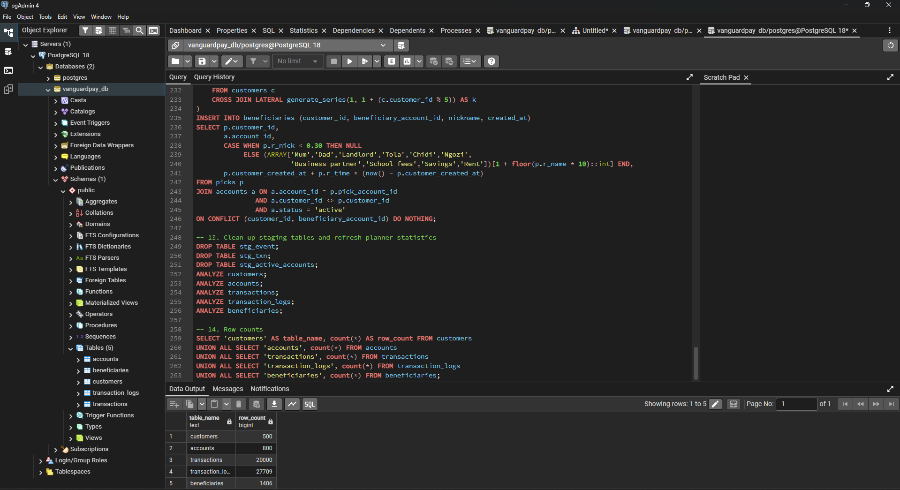
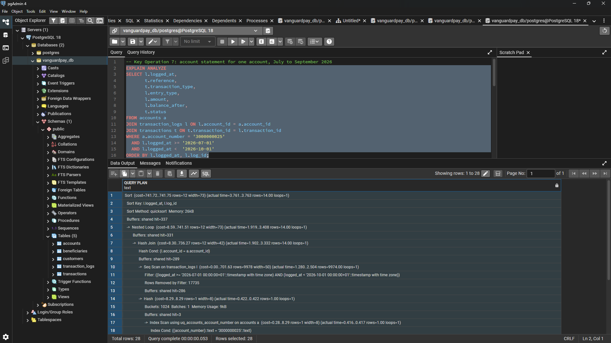
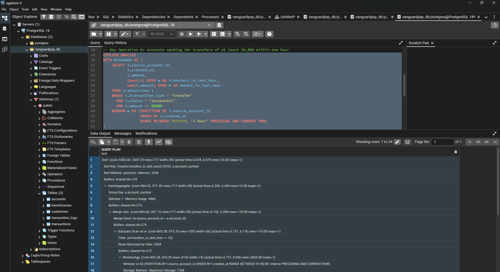
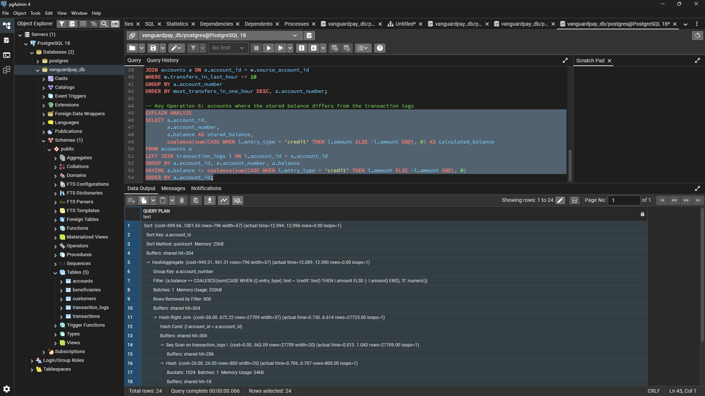
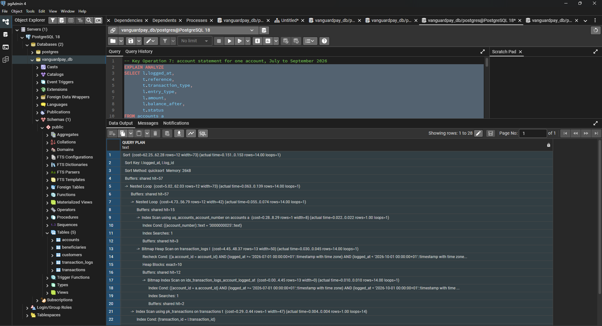
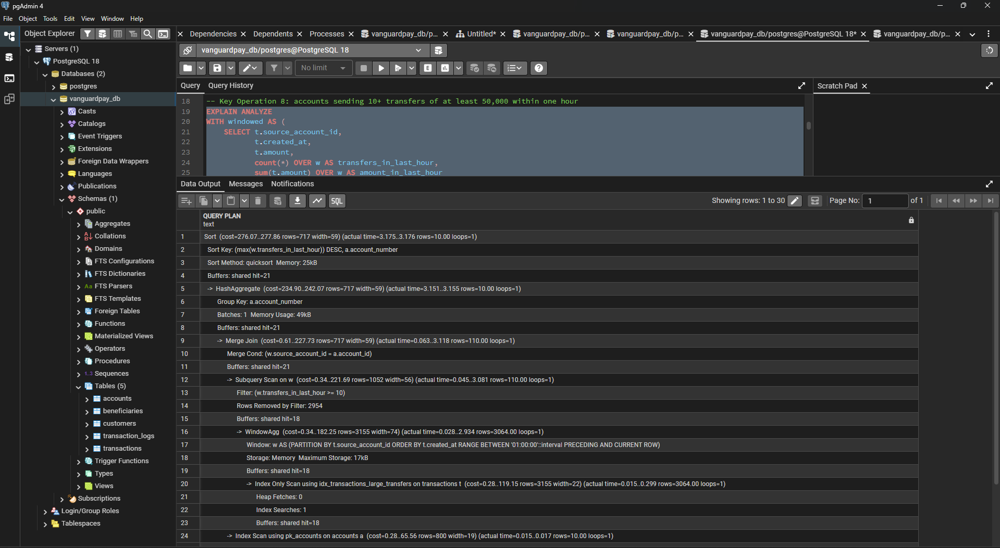
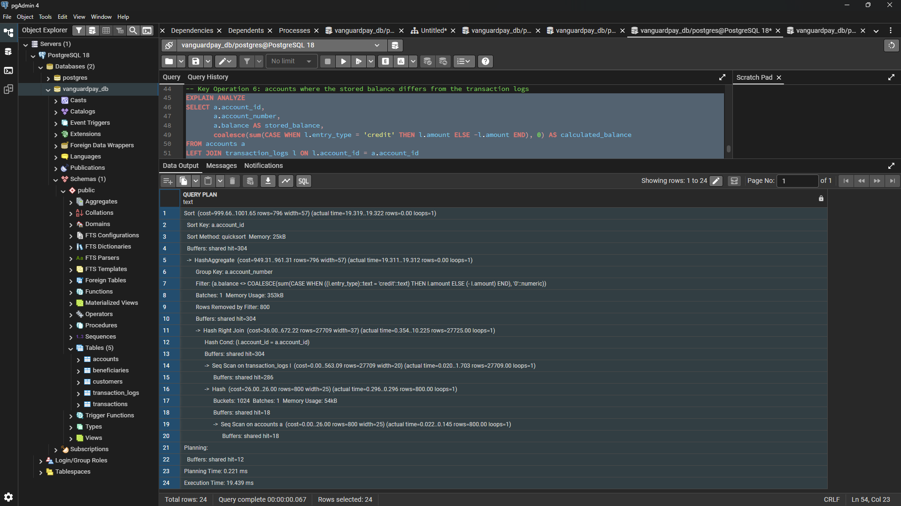

# Portfolio 2: Query Processing and Optimisation

**Case study:** VanguardPay

**Database system:** PostgreSQL, managed with pgAdmin 4

## Goal

The goal of this portfolio is to examine how PostgreSQL executes queries on the VanguardPay database and how to optimise slow queries. I will write SQL queries for core VanguardPay operations, inspect their execution plans using `EXPLAIN ANALYZE`, add targeted indexes, and compare the execution plans and timings before and after indexing.

## How This Builds on Portfolio 1

In Portfolio 1, I designed and built the five relational tables for VanguardPay: `customers`, `accounts`, `transactions`, `transaction_logs`, and `beneficiaries`. In this portfolio, I use that schema to implement and optimise three of the Key Operations from my case study:

| Key Operation | What the query does | Main tables |
|---|---|---|
| **6. Audit account balances** | Compares each account's stored `accounts.balance` against the sum of credits minus debits in `transaction_logs` to flag any discrepancy. | `accounts`, `transaction_logs` |
| **7. Generate account statements** | Returns every ledger entry for a specific customer or account within a chosen date range, ordered chronologically. | `customers`, `accounts`, `transaction_logs`, `transactions` |
| **8. Detect and flag suspicious activity** | Identifies unusually large transfers and accounts executing rapid transfer bursts within a short window. | `transactions`, `accounts` |

I selected these three operations because they filter, join, and aggregate across the largest tables in the database (`transactions` and `transaction_logs`), where performance bottlenecks would appear first on a live payment platform.

## Why I Generated a Larger Dataset First

The test script from Portfolio 1 (`test_constraints.sql`) only inserted a handful of rows to verify my constraints. That small dataset is not suitable for query optimisation testing for two reasons:

1. **PostgreSQL ignores indexes on tiny tables:** When a table only contains a few rows, reading the entire table in a single sequential pass is cheaper than reading an index page plus a table page. The query planner will pick a sequential scan (`Seq Scan`) every time, making it impossible to test whether an index works.
2. **Timings on small tables are too small to compare:** Every query finishes in a fraction of a millisecond, so execution times do not reveal bottlenecks.

To test performance properly, I wrote `seed_large_data.sql` using `generate_series()` to populate the five tables with higher row volumes before running any `EXPLAIN ANALYZE` tests:

| Table | Rows |
|---|---|
| `customers` | 500 |
| `accounts` | 800 |
| `transactions` | 20,000 |
| `transaction_logs` | ~27,500 |
| `beneficiaries` | ~1,400 |

I structured `seed_large_data.sql` around five rules so that my performance tests reflect realistic platform data:

- **Follows all schema constraints:** Account numbers are 10 digits, every transaction satisfies `ck_transactions_type_accounts`, and opening deposits are sized so no running balance ever drops below zero.
- **Maintains ledger consistency:** Every successful or reversed transaction generates matching debit and credit entries in `transaction_logs`, and each account's stored `balance` equals its total credits minus debits. Because of this, my balance audit query (Key Operation 6) returns zero mismatches on a clean run unless I deliberately introduce a discrepancy to test it.
- **Includes varied statuses:** Transactions are distributed across `successful`, `failed`, `pending`, and `reversed`, and accounts include `active`, `frozen`, and `closed` statuses, forcing my queries to filter selectively.
- **Plants suspicious transfer patterns:** About 1% of transactions are high-value transfers, and 10 accounts each execute 20 rapid transfers within a one-hour window so I can test my fraud detection query (Key Operation 8).
- **Refreshes planner statistics:** The script runs `ANALYZE` on all five tables at the end so the PostgreSQL query planner has accurate row-count statistics before I run `EXPLAIN ANALYZE`.

## Baseline Queries and Execution Plans

In `queries.sql` I wrote one query for each of Key Operations 7, 8 and 6. I tested Key Operations 7 and 8 first because both filter for a small subset of rows where indexing helps directly, followed by Key Operation 6 to test how the planner handles a full-table audit. Before adding any new index, I ran each one with `EXPLAIN ANALYZE` in pgAdmin 4 (PostgreSQL 18) and recorded the plan. After running `seed_large_data.sql`, the tables held 500 customers, 800 accounts, 20,000 transactions and 27,709 transaction logs.



For each plan I looked at three things: the scan type, the execution time in milliseconds, and the shared buffer hits. A buffer hit is one 8 KB page read from memory, so fewer hits means less work. Timings change a little from run to run, so I use buffer hits alongside them.

### Query 1: Key Operation 7 (account statement)

This query returns the statement for account `3000000025` from 1 July to 30 September 2026. It joins `accounts`, `transaction_logs` and `transactions` and returned 14 rows.

**What the baseline plan did.** PostgreSQL found the account through the unique index on `account_number`, but then ran a **Seq Scan on `transaction_logs`**. It read all 27,709 log rows, kept the 9,974 that fall inside the date range (`Rows Removed by Filter: 17735`), and hash-joined them to the account. That join reduced them to my 14 rows. It then looked up each transaction through `pk_transactions` and sorted the result. The total cost was 741.72, with 337 buffer hits (286 of them from the log scan), and the execution time was 4.583 ms.

**Why it happened.** `transaction_logs` has no index on `account_id` or `logged_at`. PostgreSQL does not create an index on a foreign key column automatically, so it could not use the one selective condition in the query (the account) to find rows. It had to read the whole table, filter by date, and only then join down to one account.



### Query 2: Key Operation 8 (suspicious activity)

This query flags accounts that sent 10 or more successful transfers of at least ₦50,000 within one hour. It uses a window function to count each account's transfers over the previous hour. It flagged the 10 burst accounts I seeded.

**What the baseline plan did.** PostgreSQL ran a **Seq Scan on `transactions`**, reading all 20,000 rows to keep 3,064 (`Rows Removed by Filter: 16936`). It then sorted those rows by `source_account_id, created_at` (quicksort, 216 kB) before the `WindowAgg`. The filter `transfers_in_last_hour >= 10` kept 110 rows and removed 2,954. A merge join with `accounts`, a `HashAggregate` and a final sort produced the 10 accounts. The total cost was 1005.50, with 278 buffer hits (272 from the seq scan), and the execution time was 7.624 ms.

**Why it happened.** There was no index to find large, successful transfers, so the whole table was read. The window function also needs its rows grouped by account and ordered by time, so PostgreSQL had to sort the 3,064 rows first. The seq scan and the sort were the two bottlenecks.



### Query 3: Key Operation 6 (balance audit)

This query adds up credits minus debits in `transaction_logs` for every account and returns any account whose stored `balance` is different.

**What the baseline plan did.** PostgreSQL ran a Seq Scan on `transaction_logs` (27,709 rows, 286 buffer hits) and on `accounts` (800 rows, 18 buffer hits). It joined them with a Hash Right Join, then used a `HashAggregate` to total each account. The filter removed all 800 accounts, so the query returned 0 rows, which means every stored balance matches its logs. The total cost was 999.66, with 304 buffer hits, and the execution time was 12.203 ms.

**Why it happened.** An audit has to read every log row to work out every account's balance. A sequential scan is the natural plan for that, so this is not a bottleneck caused by a missing index.



## Indexing Strategy and Post-Index Comparison

In `indexes.sql` I created two indexes for Key Operations 7 and 8. I ran the `CREATE INDEX` and `ANALYZE` statements first, then ran `VACUUM ANALYZE transactions;` on its own, because `VACUUM` cannot run inside a script with other statements.

### Index 1: composite index for Key Operation 7

```sql
CREATE INDEX idx_transaction_logs_account_logged_at
    ON transaction_logs (account_id, logged_at);
```

The statement query checks one exact account (`account_id = ...`) and a date range (`logged_at`). I put `account_id` first so PostgreSQL can jump straight to that account's entries, and `logged_at` second so it can read only the dates in range within that account. With the columns the other way round, PostgreSQL would have to read the date range for every account. The index also helps any other join from `accounts` to `transaction_logs`.

**Result.** The Seq Scan on `transaction_logs` was replaced by a Bitmap Index Scan on `idx_transaction_logs_account_logged_at`, with `Heap Blocks: exact=10`. The 17,735-row filter no longer appears. Buffer hits dropped from 337 to 57, and the execution time dropped from 4.583 ms to 0.203 ms.



### Index 2: partial covering index for Key Operation 8

```sql
CREATE INDEX idx_transactions_large_transfers
    ON transactions (source_account_id, created_at)
    INCLUDE (amount)
    WHERE transaction_type = 'transfer'
      AND status = 'successful'
      AND amount >= 50000;
```

I built this index around the three things the query needs:

- **Partial:** the `WHERE` clause means the index only holds successful transfers of at least ₦50,000. That is about 3,064 of the 20,000 transactions, so the index stays small and costs less to maintain. It only works for queries that repeat the same three conditions, and my query does.
- **Key order:** `(source_account_id, created_at)` matches the window's `PARTITION BY` and `ORDER BY`. The rows come out of the index already in the order the window function needs, so the sort is no longer required.
- **Covering:** `INCLUDE (amount)` stores the amount in the index, so PostgreSQL does not need to visit the table at all.

I ran `VACUUM ANALYZE` because an index-only scan relies on the table's visibility map. `VACUUM` updates that map, which lets PostgreSQL trust the index without double-checking each row in the table.

**Result.** The Seq Scan and the Sort were replaced by an Index Only Scan on `idx_transactions_large_transfers` with `Heap Fetches: 0`. Buffer hits dropped from 278 to 21, and the execution time dropped from 7.624 ms to 2.790 ms.



### Key Operation 6: no index added

I did not add an index for the balance audit. The query needs every row of `transaction_logs`, so reading the table once in order is cheaper than going through an index thousands of times. When I re-ran it after creating the two indexes, the plan was the same: the same two Seq Scans, 304 buffer hits and a cost of 999.66. The execution time was 19.439 ms against 12.203 ms before. I did not change anything that affects this query, and the buffer hits did not change, so I treat the difference as normal variation between runs and not as a real slowdown.



*Query 3 plan after indexing: the same two sequential scans, 304 buffer hits, and a total cost of 999.66.*

### Before vs After

| Key Operation | Plan before | Plan after | Buffer hits | Execution time | Top-level cost |
|---|---|---|---|---|---|
| 7: account statement | Seq Scan on `transaction_logs`, hash join | Bitmap Index Scan on `idx_transaction_logs_account_logged_at` | 337 → 57 (83% fewer) | 4.583 ms → 0.203 ms (about 23× faster) | 741.72 → 62.25 |
| 8: suspicious activity | Seq Scan on `transactions`, then Sort | Index Only Scan on `idx_transactions_large_transfers`, no Sort, `Heap Fetches: 0` | 278 → 21 (92% fewer) | 7.624 ms → 2.790 ms (about 2.7× faster) | 1005.50 → 276.07 |
| 6: balance audit | Seq Scans on `transaction_logs` and `accounts` | Same plan (no index added) | 304 → 304 | 12.203 ms → 19.439 ms (same plan, run-to-run variation) | 999.66 → 999.66 |

Times are execution times only and exclude planning time.

## Reflection

The main thing I learned is that an index only helps if it matches the shape of the query. For Key Operation 7 the order of the columns in the composite index mattered, and for Key Operation 8 the `WHERE` clause, the key order and `INCLUDE (amount)` all had to line up with the query before PostgreSQL would use an index-only scan. I also learned that an index-only scan needs the table to be vacuumed first, and that `VACUUM` has to be run on its own in pgAdmin 4, not inside a script with other statements.

Key Operation 6 taught me that not every slow-looking query needs an index. The audit has to read every log row, so the sequential scan was the right plan, and I could back that up with the plan itself.

I also learned to read execution plans properly: the scan type, the `Rows Removed by Filter` lines, and the buffer hits. The buffer hits turned out to be steadier than the timings. Key Operation 6 had an identical plan and identical buffer hits on both runs, but its time went from 12.203 ms to 19.439 ms.

There are limits to what I measured. The tables are small (27,709 log rows), so every query runs in milliseconds and the absolute gains are small. I expect the seq scans to cost much more at a real fintech's scale, but I have not tested that. I tested one account and one threshold of ₦50,000. Indexes also cost something on writes, because every deposit and transfer adds rows to `transactions` and `transaction_logs` and the indexes have to be updated too. I want to keep that in mind in Portfolio 3 when I test transfers and concurrent access.

## AI Use Declaration

**Tool used:** Claude (Anthropic).

**What I used it for:** I used Claude as a learning partner to clarify query processing, EXPLAIN ANALYZE plan metrics, and composite vs partial covering index design, as well as to assist with SQL scripting for seed_large_data.sql, queries.sql, and indexes.sql.

**How I reviewed and verified the output:** I ran every script in pgAdmin 4 myself. I took all the execution plans and screenshots from my own runs, and the numbers in this README come from my own `EXPLAIN ANALYZE` output.
