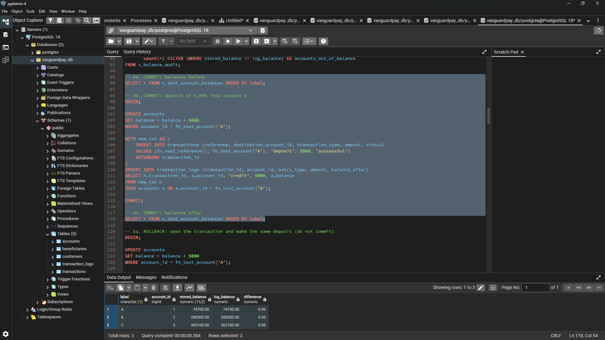
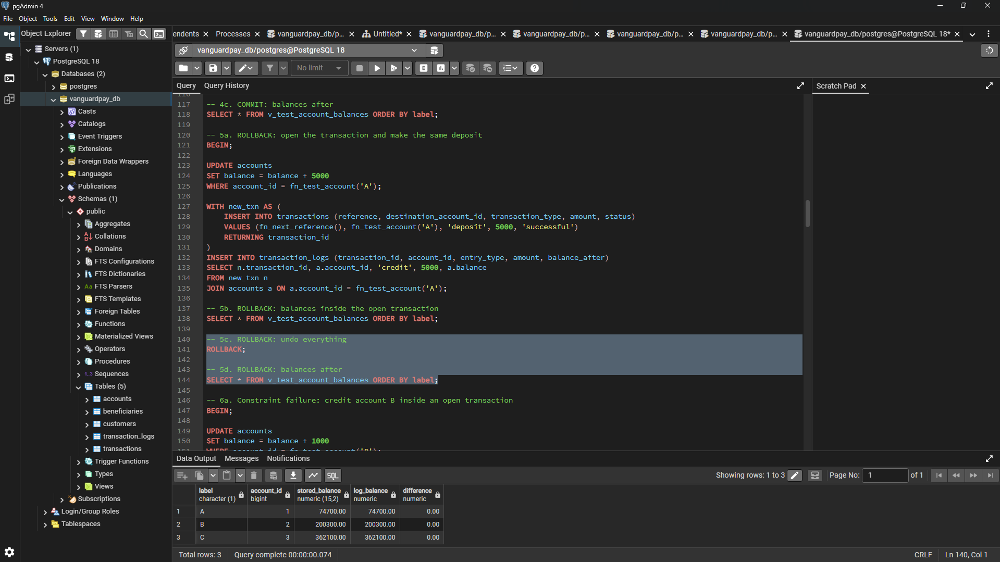
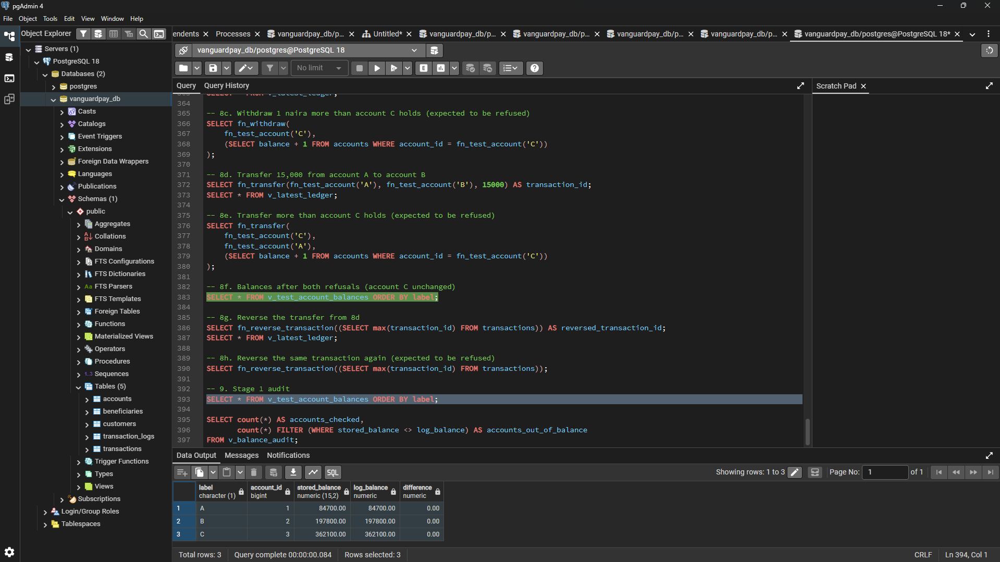

# Portfolio 3: Transactions and Concurrency Control

**Case study:** VanguardPay

**Database system:** PostgreSQL, managed with pgAdmin 4

## Overview

In this Portfolio , I tested how the VanguardPay database keeps money safe when one operation needs several steps that must all succeed together, and when more than one session touches the same account at the same time. I ran all the work on the seeded database from Portfolio 2.

I split the work into three SQL scripts: `transactions_atomic.sql` (commit, rollback and atomic operations), `concurrency_locking.sql` (lost updates, row locking and deadlocks) and `isolation_levels.sql` (READ COMMITTED against REPEATABLE READ). 

## Key Operations Covered

| Key Operation | What I built |
|---|---|
| 2. Deposit funds | `fn_deposit` updates the balance, writes the `transactions` row and writes the credit log in one transaction |
| 3. Withdraw funds | `fn_withdraw` refuses the request when the balance is too low |
| 4. Transfer funds | `fn_transfer` writes the debit and the credit together, with two log rows |
| 5. Reverse failed transactions | `fn_reverse_transaction` puts the money back, logs the opposite entries and sets the status to `reversed`, the same way my seed script models reversals |
| 6. Audit account balances | `v_balance_audit` compares each stored balance with the credits minus debits in `transaction_logs`. I ran it before and after my tests |

## Stage 1: Atomic Transactions (`transactions_atomic.sql`)

### Test accounts

I picked three active accounts that belong to different customers and hold at least `50000` NGN, and stored them in a small `test_accounts` table with the labels A, B and C. Every test in this portfolio uses these same three accounts. Before any test, account A (`3000000001`) held `69700.00`, account B (`3000000002`) held `200300.00` and account C (`3000000003`) held `362100.00`.

*Accounts A, B and C and their starting balances before any test.*

### What I built

- I created `seq_transaction_reference` and `fn_next_reference()` so new transaction references start at `90000001` and never clash with the seeded `VGP` references.
- I wrote three views: `v_balance_audit` (stored balance against log balance for every account), `v_test_account_balances` (the same audit for accounts A, B and C) and `v_latest_ledger` (the log rows of the most recent transaction).
- I ran the balance audit once before any test, so I had a clean starting point to compare against.
- I wrote `fn_deposit`, `fn_withdraw`, `fn_transfer` and `fn_reverse_transaction` as PL/pgSQL functions, so the balance update, the `transactions` row and the `transaction_logs` rows succeed or fail as one unit. `fn_transfer` and `fn_reverse_transaction` lock the account rows in `account_id` order.

### How I ran the script

pgAdmin 4 runs everything in the editor when no text is highlighted, so I highlighted one numbered block at a time and pressed F5. I ran every block in the same Query Tool tab, because one tab is one database session. A transaction opened with `BEGIN` belongs to that session, so if I had switched tabs between `BEGIN` and `COMMIT`, the statements would not have been part of the same transaction. Staying in one tab let me stop between steps, run a `SELECT` inside the open transaction to see the uncommitted change, and then finish with `COMMIT` or `ROLLBACK`.

### COMMIT

I opened a transaction with `BEGIN`, deposited `5000` into account A, wrote the `transactions` row and the credit log, and ended with `COMMIT`. Account A moved from `69700.00` to `74700.00`. Accounts B and C stayed at `200300.00` and `362100.00`, and the stored balance matched the log balance on all three accounts (difference `0.00`).

*After `COMMIT`, account A holds `74700.00` and every difference is `0.00`.*

### ROLLBACK

I repeated the same `5000` deposit but ended the transaction with `ROLLBACK`. Inside the open transaction, the balance check showed the deposit. After `ROLLBACK`, account A went back to `74700.00` and the deposit's `transactions` row and log row were gone, so the change never became permanent.

*After `ROLLBACK`, account A is back at `74700.00`.*

### Constraint failure

I opened a transaction, credited account B with `1000`, and then tried to debit account A by `1` naira more than its balance. The `ck_accounts_balance` constraint rejected the debit, and PostgreSQL refused every further statement until I ran `ROLLBACK`. The rollback also removed the earlier credit to account B, so B returned to `200300.00`. This showed me that one failed step cancels the whole transaction, not just the step that failed.

*The ck_accounts_balance constraint error on account A aborting the open transaction.*

### Atomic functions

I tested each function with a success case and a failure case:

- `fn_deposit` added `10000` to account A.
- `fn_withdraw` took `2500` from account B.
- `fn_withdraw` refused a withdrawal of `1` naira more than account C holds.
- `fn_transfer` moved `15000` from account A to account B.
- `fn_transfer` refused a transfer of `1` naira more than account C holds.
- `fn_reverse_transaction` reversed the transfer, and a second reversal of the same transfer was refused because only `successful` transactions can be reversed.

After both refusals, account C was unchanged at `362100.00`, so a refused operation left no half-finished change behind.

The transfer was transaction `20005` (`VGP2026102790000005`) for `15000.00`. Its ledger after the reversal looked like this:

| log_id | account_id | entry_type | balance_after |
|---|---|---|---|
| `27714` | `1` | `debit` | `69700.00` |
| `27715` | `2` | `credit` | `212800.00` |
| `27716` | `2` | `debit` | `197800.00` |
| `27717` | `1` | `credit` | `84700.00` |

The first two rows are the original transfer (account A debited, account B credited). The last two rows are the reversal, which puts the `15000.00` back: account B is debited down to `197800.00` and account A is credited back up to `84700.00`. The transaction status is now `reversed`, and the original log rows stay in place, so the audit trail keeps both the transfer and its reversal.

*The four ledger rows for transaction `20005`: the transfer legs and the reversal legs.*

The transfer got `transaction_id` `20005` and `log_id` `27714` to `27717` even though the rolled-back deposit never became permanent. PostgreSQL does not give identity numbers back when a transaction rolls back, so the rolled-back deposit still used up an id, and gaps in the numbering are normal.

### Final audit

After all the Stage 1 tests, account A held `84700.00`, account B held `197800.00` and account C held `362100.00`, with a difference of `0.00` on each. Across the whole database, the balance audit checked `800` accounts and found `0` out of balance.

*Final Stage 1 balances for accounts A, B and C showing zero variance between stored and ledger balances.*

### Results

- `COMMIT` made the deposit permanent, and `ROLLBACK` removed it completely, including its `transactions` row and log row.
- A constraint failure in the middle of a transaction cancelled the whole transaction, including the earlier credit to account B.
- Each function wrote the balance change, the `transactions` row and the log rows as one unit, and the refused operations changed nothing.
- The reversal restored accounts A and B to their earlier balances and kept both the transfer and the reversal in the ledger.
- Stored balances still equalled the sum of the logs on every account after all of these tests.
