# Portfolio 3: Transactions and Concurrency Control

**Case study:** VanguardPay

**Database system:** PostgreSQL, managed with pgAdmin 4

## Overview

In this Portfolio , I tested how the VanguardPay database keeps money safe when one operation needs several steps that must all succeed together, and when more than one session touches the same account at the same time. I ran all the work on the seeded database from Portfolio 2.

I split the work into three SQL scripts: `transactions_atomic.sql` (commit, rollback and atomic operations), `concurrency_locking.sql` (lost updates, row locking and deadlocks) and `isolation_levels.sql` (READ COMMITTED against REPEATABLE READ). 

### Key Operations Covered

| Key Operation | What I Built |
| :--- | :--- |
| **2. Deposit funds** | `fn_deposit` updates the balance, writes the transactions row, and records the credit log in one transaction. |
| **3. Withdraw funds** | `fn_withdraw` enforces funds verification and blocks execution when the balance is insufficient. |
| **4. Transfer funds** | `fn_transfer` debits the sender and credits the receiver atomically with matching ledger rows. |
| **5. Reverse failed transactions** | `fn_reverse_transaction` credits/debits the offsetting amounts, appends reversal logs, and flags status as `reversed`. |
| **6. Audit account balances** | `v_balance_audit` checks for reconciliation drift across all accounts by comparing stored balance to net ledger movements. |

## Stage 1: Atomic Transactions (`transactions_atomic.sql`)

### Test accounts

I picked three active accounts that belong to different customers and hold at least `50000` NGN, and stored them in a small `test_accounts` table with the labels A, B and C. Every test in this portfolio uses these same three accounts. Before any test, account A (`3000000001`) held `69700.00`, account B (`3000000002`) held `200300.00` and account C (`3000000003`) held `362100.00`.

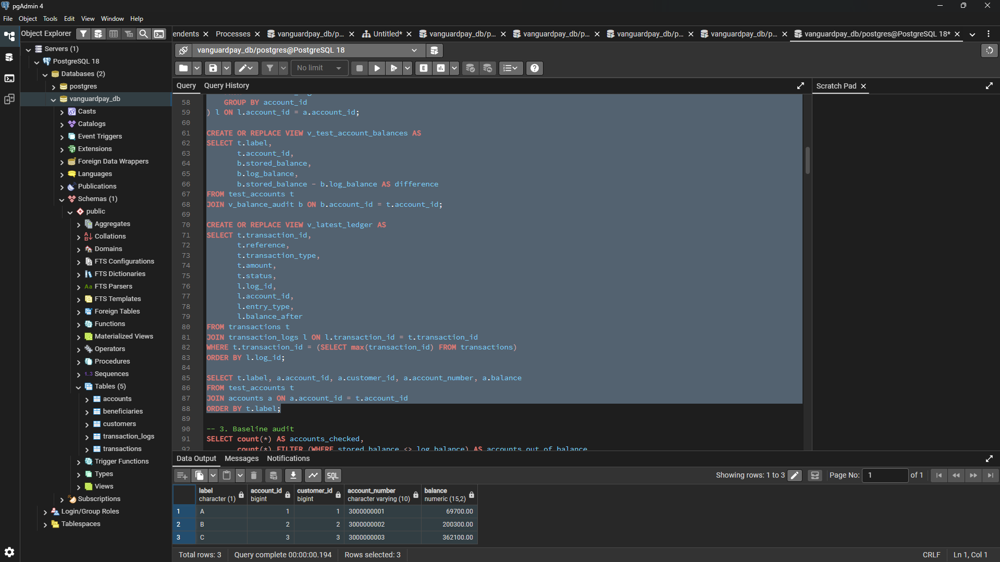

*Accounts A, B and C and their starting balances before any test.*

### What I built

- I created `seq_transaction_reference` and `fn_next_reference()` so new transaction references start at `90000001` and never clash with the seeded `VGP` references.
- I wrote three views: `v_balance_audit` (stored balance against log balance for every account), `v_test_account_balances` (the same audit for accounts A, B and C) and `v_latest_ledger` (the log rows of the most recent transaction).
- I ran the balance audit once before any test, so I had a clean starting point to compare against.
- I wrote `fn_deposit`, `fn_withdraw`, `fn_transfer` and `fn_reverse_transaction` as PL/pgSQL functions, so the balance update, the `transactions` row and the `transaction_logs` rows succeed or fail as one unit. `fn_transfer` and `fn_reverse_transaction` lock the account rows in `account_id` order.

### How I ran the script

pgAdmin 4 runs everything in the editor when no text is highlighted, so I highlighted one numbered block at a time and pressed F5. I ran every block in the same Query Tool tab, because one tab is one database session. A transaction opened with `BEGIN` belongs to that session, so if I had switched tabs between `BEGIN` and `COMMIT`, the statements would not have been part of the same transaction. Staying in one tab let me stop between steps, run a `SELECT` inside the open transaction to see the uncommitted change, and then finish with `COMMIT` or `ROLLBACK`.

### COMMIT

I opened a transaction with `BEGIN`, deposited `5000` into account A, wrote the `transactions` row and the credit log, and ended with `COMMIT`. Account A moved from `69700.00` to `74700.00`. Accounts B and C stayed at `200300.00` and `362100.00`, and the stored balance matched the log balance on all three accounts (difference `0.00`).


*After `COMMIT`, account A holds `74700.00` and every difference is `0.00`.*

### ROLLBACK

I repeated the same `5000` deposit but ended the transaction with `ROLLBACK`. Inside the open transaction, the balance check showed the deposit. After `ROLLBACK`, account A went back to `74700.00` and the deposit's `transactions` row and log row were gone, so the change never became permanent.


*After `ROLLBACK`, account A is back at `74700.00`.*

### Constraint failure

I opened a transaction, credited account B with `1000`, and then tried to debit account A by `1` naira more than its balance. The `ck_accounts_balance` constraint rejected the debit, and PostgreSQL refused every further statement until I ran `ROLLBACK`. The rollback also removed the earlier credit to account B, so B returned to `200300.00`. This showed me that one failed step cancels the whole transaction, not just the step that failed.

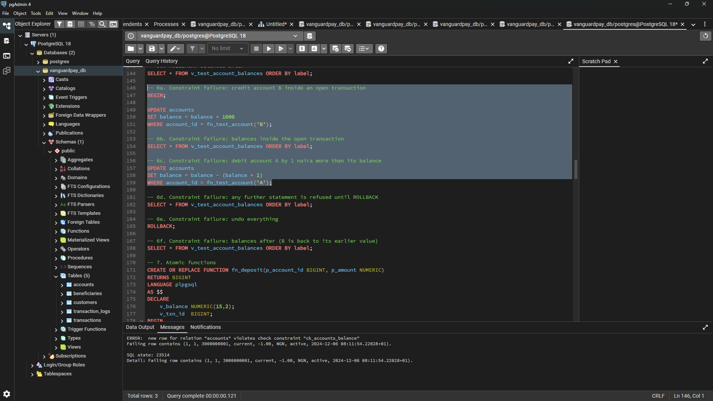

*The ck_accounts_balance constraint error on account A aborting the open transaction.*

### Atomic functions

I tested each function with a success case and a failure case:

- `fn_deposit` added `10000` to account A.
- `fn_withdraw` took `2500` from account B.
- `fn_withdraw` refused a withdrawal of `1` naira more than account C holds.
- `fn_transfer` moved `15000` from account A to account B.
- `fn_transfer` refused a transfer of `1` naira more than account C holds.
- `fn_reverse_transaction` reversed the transfer, and a second reversal of the same transfer was refused because only `successful` transactions can be reversed.

After both refusals, account C was unchanged at `362100.00`, so a refused operation left no half-finished change behind.

The transfer was transaction `20005` (`VGP2026102790000005`) for `15000.00`. Its ledger after the reversal looked like this:

| log_id | account_id | entry_type | amount | balance_after |
| :--- | :--- | :--- | :--- | :--- |
| 27714 | 1 | debit | 15000.00 | 69700.00 |
| 27715 | 2 | credit | 15000.00 | 212800.00 |
| 27716 | 2 | debit | 15000.00 | 197800.00 |
| 27717 | 1 | credit | 15000.00 | 84700.00 |

The first two rows are the original transfer (account A debited, account B credited). The last two rows are the reversal, which puts the `15000.00` back: account B is debited down to `197800.00` and account A is credited back up to `84700.00`. The transaction status is now `reversed`, and the original log rows stay in place, so the audit trail keeps both the transfer and its reversal.

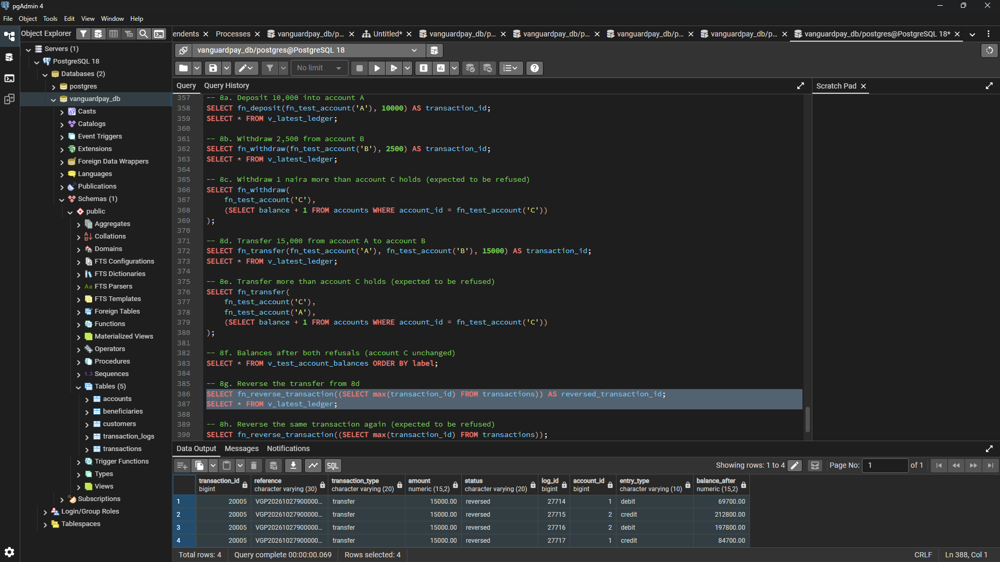

*The four ledger rows for transaction `20005`: the transfer legs and the reversal legs.*

The transfer got `transaction_id` `20005` and `log_id` `27714` to `27717` even though the rolled-back deposit never became permanent. PostgreSQL does not give identity numbers back when a transaction rolls back, so the rolled-back deposit still used up an id, and gaps in the numbering are normal.

### Final audit

After all the Stage 1 tests, account A held `84700.00`, account B held `197800.00` and account C held `362100.00`, with a difference of `0.00` on each. Across the whole database, the balance audit checked `800` accounts and found `0` out of balance.


*Final Stage 1 balances for accounts A, B and C showing zero variance between stored and ledger balances.*

### Results

- `COMMIT` made the deposit permanent, and `ROLLBACK` removed it completely, including its `transactions` row and log row.
- A constraint failure in the middle of a transaction cancelled the whole transaction, including the earlier credit to account B.
- Each function wrote the balance change, the `transactions` row and the log rows as one unit, and the refused operations changed nothing.
- The reversal restored accounts A and B to their earlier balances and kept both the transfer and the reversal in the ledger.
- Stored balances still equalled the sum of the logs on every account after all of these tests.


## Stage 2: Concurrency and Locking (`concurrency_locking.sql`)
 
### How I tested two sessions
 
I opened two Query Tool tabs in pgAdmin 4 on the same database, which I call Tab 1 and Tab 2. Each tab is its own session, so I could play two customers acting at the same moment. To make the overlap repeatable, I wrote my demo functions with a `pg_sleep(30)` pause between reading a balance and writing it. I started the call in Tab 1, switched to Tab 2 straight away, and started the matching call there while Tab 1 was still paused.
 
### What I built
 
- I created `test_checkpoint`, `fn_take_test_checkpoint()` and `fn_reset_to_checkpoint()`. The checkpoint saves the balances of accounts A, B and C and the latest `transaction_id` and `log_id`. The reset deletes only the rows created after the checkpoint and restores those three balances, so I could undo a test that deliberately damages the data. I only used it on my three test accounts.
- I created the view `v_test_activity`, which lists the ledger rows created since the last checkpoint.
- I wrote `fn_withdraw_no_lock` and `fn_withdraw_locked`. They are identical except that the locked version reads the balance with `SELECT ... FOR UPDATE`.
- I wrote `fn_transfer_demo`, which locks the first account, pauses, and then locks the second account. Its `p_ordered` flag decides whether it locks the source first or the lower `account_id` first.
### Lost update and double-spend without locking
 
Account C held `362100.00`. In both tabs, I called `fn_withdraw_no_lock` for 60% of C's balance, which is `217260.00` each. Together the two withdrawals ask for 120% of the balance. Both sessions read `362100.00` before either one wrote, so both passed the balance check, and both returned a `transaction_id` with no error.
 
| transaction_id | reference | amount | log_id | account_id | entry_type | balance_after |
|---|---|---|---|---|---|---|
| `20006` | `VGP2026102990000006` | `217260.00` | `27718` | `3` | `debit` | `144840.00` |
| `20007` | `VGP2026102990000007` | `217260.00` | `27719` | `3` | `debit` | `144840.00` |
 
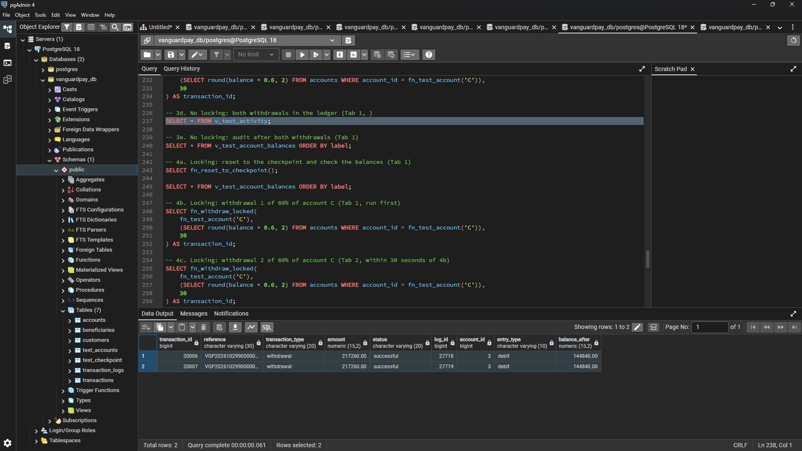
 
*Both withdrawals ended at the same balance, because the second session overwrote the first.*
 
The balance audit exposed the damage. Account C's stored balance was `144840.00`, but the logs add up to `-72420.00`, a difference of `217260.00`. C paid out `434520.00` against a balance of `362100.00`, and the stored balance hid it. Accounts A and B stayed at `84700.00` and `197800.00` with a difference of `0.00`.
 
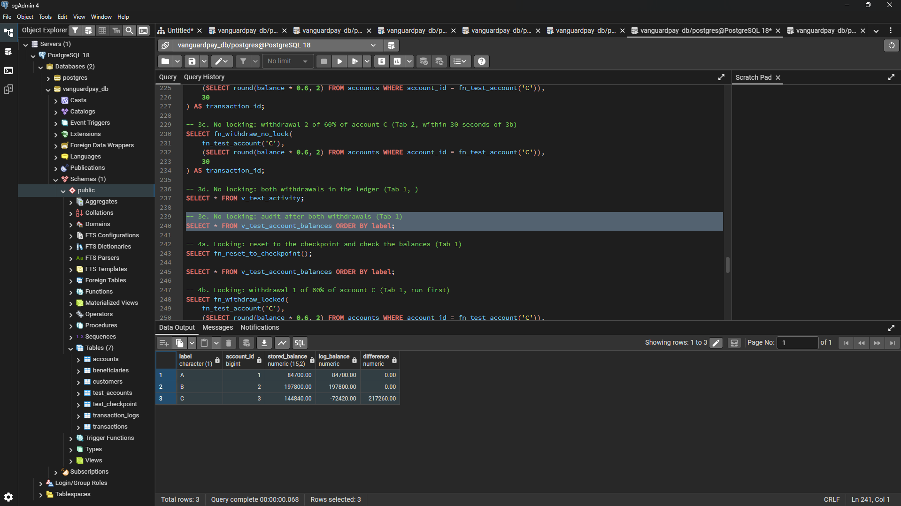
 
*The audit catches the lost update: account C's stored balance is `217260.00` higher than its ledger.*
 
After taking my screenshots, I ran `fn_reset_to_checkpoint()` to delete both withdrawals and put account C back to `362100.00`, so the screenshots are my evidence for this test.
 
### Fix with SELECT ... FOR UPDATE
 
I ran the same two calls again with `fn_withdraw_locked`. Tab 1 locked account C's row when it read the balance. Tab 2 reached the same row and had to wait.
 
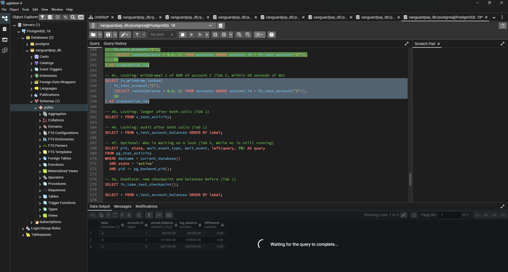
 
*Tab 2 waiting on the row lock that Tab 1 holds.*
 
When Tab 1 finished, Tab 2 read the new balance and refused the withdrawal:
 
```
ERROR:  Withdrawal of 217260.00 refused: balance is only 144840.00
CONTEXT:  PL/pgSQL function fn_withdraw_locked(bigint,numeric,integer) line 13 at RAISE
SQL state: P0001
```
 
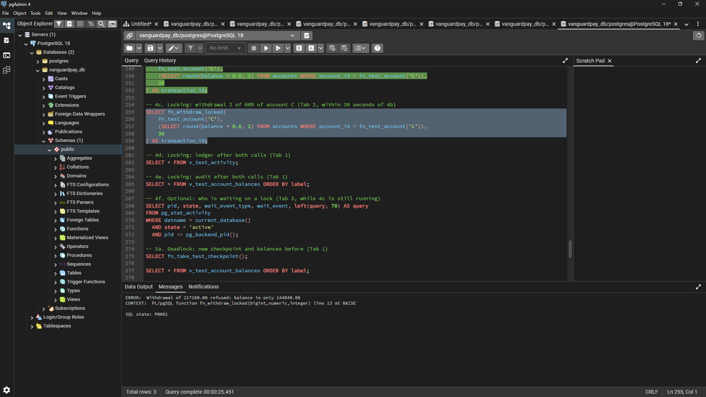
 
*The second withdrawal is refused because it saw the balance after the first one.*
 
The audit confirmed it. Account C's stored balance and log balance both equal `144840.00` (difference `0.00`), and accounts A and B are unchanged. The lock turned a double-spend into one successful withdrawal and one refusal.
 
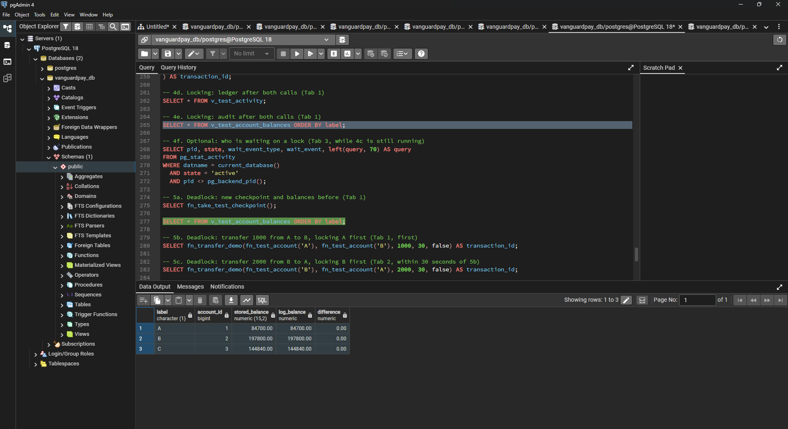
 
*With the lock, account C's stored balance equals its ledger.*
 
### Deadlock
 
I took a new checkpoint and ran `fn_transfer_demo` with `p_ordered` set to `false`. In Tab 1, I transferred `1000` from account A to account B, which locks A first. In Tab 2, I transferred `2000` from account B to account A, which locks B first. After the pause, each tab needed the row the other one held. PostgreSQL detected the cycle and cancelled one transaction:
 
```
ERROR:  deadlock detected
Process 24240 waits for ShareLock on transaction 810; blocked by process 13880.
Process 13880 waits for ShareLock on transaction 811; blocked by process 24240.
SQL state: 40P01
Context: while locking tuple (9,1) in relation "accounts"
SQL statement "SELECT 1 FROM accounts WHERE account_id = v_second FOR UPDATE"
PL/pgSQL function fn_transfer_demo(bigint,bigint,numeric,integer,boolean) line 19 at PERFORM
```
 
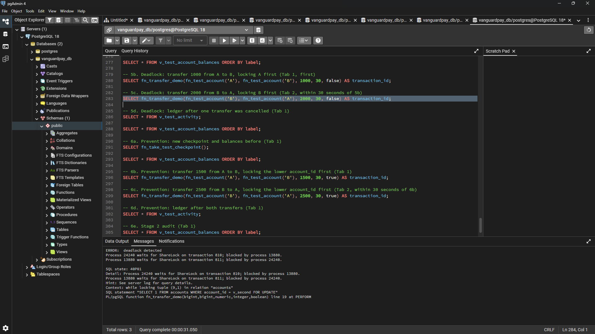
 
*PostgreSQL cancels one of the two opposite transfers with `deadlock detected`.*
 
The `1000` transfer from A to B committed, and the cancelled `2000` transfer from B to A was rolled back completely, so no half-finished transfer was left behind.
 
### Deadlock prevention
 
I took another checkpoint and ran the same opposite transfers with `p_ordered` set to `true`, so both sessions lock the lower `account_id` first. Tab 1 transferred `1500` from A to B and Tab 2 transferred `2500` from B to A. Tab 2 waited for account A, because Tab 1 held it, and carried on once Tab 1 finished. Nothing was cancelled, and both transfers succeeded:
 
| transaction_id | reference | amount | log_id | account_id | entry_type | balance_after |
|---|---|---|---|---|---|---|
| `20011` | `VGP2026102990000011` | `1500.00` | `27724` | `1` | `debit` | `82200.00` |
| `20011` | `VGP2026102990000011` | `1500.00` | `27725` | `2` | `credit` | `200300.00` |
| `20012` | `VGP2026102990000012` | `2500.00` | `27726` | `2` | `debit` | `197800.00` |
| `20012` | `VGP2026102990000012` | `2500.00` | `27727` | `1` | `credit` | `84700.00` |
 
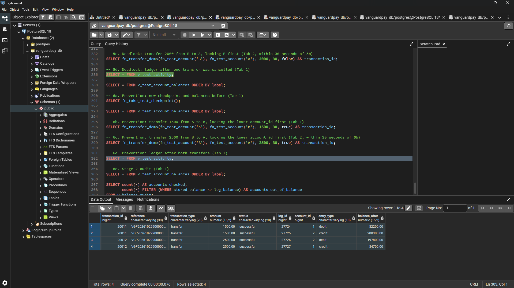
 
*With a fixed lock order, both transfers complete and the ledger holds all four rows.*
 
### Final audit
 
After the Stage 2 tests, account A held `84700.00`, account B held `197800.00` and account C held `144840.00`, with a difference of `0.00` on each. Account C is lower than at the end of Stage 1 because the locked withdrawal of `217260.00` was a valid transaction that stayed. The balance audit checked `800` accounts and found `0` out of balance.
 
### Results
 
- Without a lock, two sessions that read the same balance both passed the balance check, and the second write overwrote the first. The audit showed a difference of `217260.00` on account C.
- `SELECT ... FOR UPDATE` made the second session wait, re-read the new balance and refuse the withdrawal. Stored balance and ledger matched.
- Opposite transfers that lock accounts in different orders caused a deadlock, and PostgreSQL cancelled one of them with SQL state `40P01`.
- Locking the lower `account_id` first removed the deadlock, and both transfers completed.
- Every balance matched its ledger after the fixes, and the audit found `0` of `800` accounts out of balance.


## Stage 3: Isolation Levels (`isolation_levels.sql`)
 
### How I tested the isolation levels
 
I used the same two Query Tool tabs. In Tab 1, I opened each transaction with `BEGIN ISOLATION LEVEL ...` and kept it open. In Tab 2, I ran a deposit in normal auto-commit mode, so it committed straight away. This time the two tabs took turns, so I did not need a pause. I took a new checkpoint first, so `v_test_activity` lists only the Stage 3 deposits. In each transaction, I saved the first read of account A into a temporary table, `first_read`, which drops itself at `COMMIT`. This let one result show the first read and the second read side by side.
 
### READ COMMITTED
 
In Tab 1, I opened a `READ COMMITTED` transaction and read account A, which held `84700.00`. In Tab 2, I deposited `1000` into account A with `fn_deposit`, and it committed. When I read account A again inside the same open Tab 1 transaction, I got `85700.00`, a change of `1000.00`. `READ COMMITTED` shows each statement the latest committed data, so the same transaction read two different balances. This is a non-repeatable read.
 
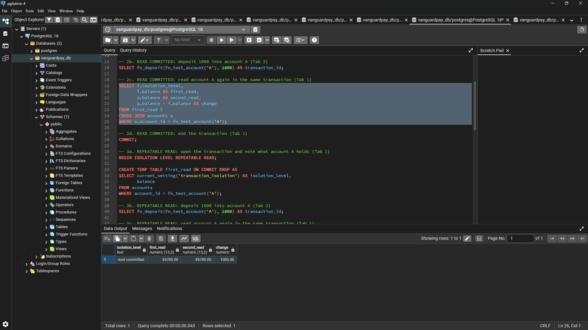
 
*Under `READ COMMITTED`, Tab 1's second read moves from `84700.00` to `85700.00`.*
 
### REPEATABLE READ
 
I repeated the test with `BEGIN ISOLATION LEVEL REPEATABLE READ`. Tab 1 read account A at `85700.00`. Tab 2 deposited another `1000` and committed. Tab 1's second read stayed at `85700.00`, a change of `0.00`, because a `REPEATABLE READ` transaction keeps the snapshot from its first statement. After I ran `COMMIT`, a normal read in Tab 1 returned `86700.00` under `read committed`, so the new deposit became visible as soon as the old snapshot ended.
 
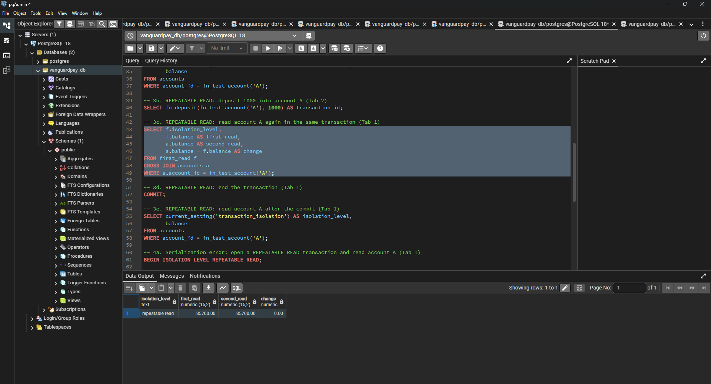
 
*Under `REPEATABLE READ`, both reads stay at `85700.00` even though Tab 2 committed a deposit.*
 
### Serialization failure and retry
 
In Tab 1, I opened a `REPEATABLE READ` transaction and read account A at `86700.00`. In Tab 2, I deposited `1000` and committed, which took account A to `87700.00`. Back in Tab 1, I called `fn_deposit` for `500`. The function's `UPDATE` hit a row that changed after Tab 1's snapshot, and PostgreSQL refused it:
 
```
ERROR:  could not serialize access due to concurrent update
CONTEXT:  SQL statement "UPDATE accounts
    SET balance = balance + p_amount
    WHERE account_id = p_account_id AND status = 'active'
    RETURNING balance"
PL/pgSQL function fn_deposit(bigint,numeric) line 10 at SQL statement
SQL state: 40001
```
 
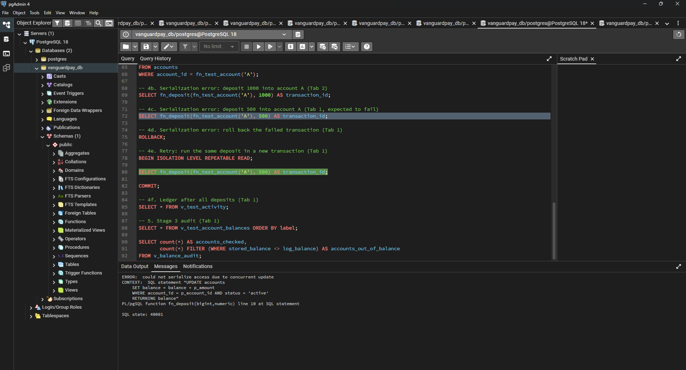
 
*`REPEATABLE READ` refuses the update because account A changed after Tab 1's snapshot.*
 
PostgreSQL does not treat this as a bug. It stops Tab 1 from writing a balance based on a stale read, which is the same lost update I showed in Stage 2. I ran `ROLLBACK`, then retried the same `500` deposit in a new `REPEATABLE READ` transaction. The new transaction took a fresh snapshot, saw `87700.00`, and the deposit committed, taking account A to `88200.00`.
 
The Stage 3 ledger held four deposits. The failed attempt left no rows, and the retry is the last row:
 
| transaction_id | reference | amount | log_id | account_id | entry_type | balance_after |
|---|---|---|---|---|---|---|
| `20013` | `VGP2026103090000013` | `1000.00` | `27728` | `1` | `credit` | `85700.00` |
| `20014` | `VGP2026103090000014` | `1000.00` | `27729` | `1` | `credit` | `86700.00` |
| `20016` | `VGP2026103090000016` | `1000.00` | `27731` | `1` | `credit` | `87700.00` |
| `20017` | `VGP2026103090000017` | `500.00` | `27732` | `1` | `credit` | `88200.00` |
 
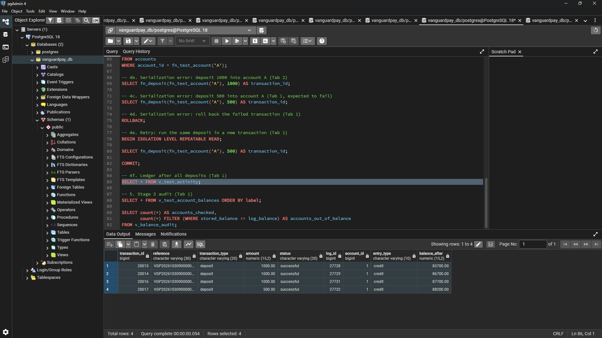
 
*The failed deposit left no ledger rows, and the retry committed as transaction `20017`.*
 
The numbering skips `20015` and `27730`. Before I ran Test 3 across both tabs, I ran an extra test in Tab 1 and ended it with `ROLLBACK;`, which used up one id. As in Stage 1, PostgreSQL does not give identity numbers back when a transaction rolls back.
 
### Final audit
 
After the Stage 3 tests, account A held `88200.00`, account B held `197800.00` and account C held `144840.00`, with a difference of `0.00` on each. The balance audit checked `800` accounts and found `0` out of balance.
 
### Results
 
- Under `READ COMMITTED`, one transaction read account A twice and got `84700.00` and then `85700.00`.
- Under `REPEATABLE READ`, both reads returned `85700.00`, even though another session committed a deposit in between.
- A `REPEATABLE READ` transaction that tried to update a row changed after its snapshot failed with SQL state `40001`, and the same deposit succeeded when I retried it in a new transaction.
- The failed attempt left no `transactions` or `transaction_logs` rows, and the audit found `0` of `800` accounts out of balance.

## Technical Reflection

### Key Insights and Trade-offs

- **Application Logic vs. Atomic Updates:** A standard single-statement `UPDATE accounts SET balance = balance - amount` in PostgreSQL is inherently safe under `READ COMMITTED` because the second transaction waits and re-evaluates the updated row. Concurrency bugs like lost updates and double-spending emerge when application code adopts a "read-then-write" pattern (reading balance into memory, evaluating business logic, then writing back an absolute value).
- **Pessimistic vs. Optimistic Concurrency:** `SELECT ... FOR UPDATE` acts as an explicit pessimistic lock, queuing concurrent sessions and preventing stale state at the cost of blocking latency. Conversely, `REPEATABLE READ` snapshot isolation avoids row-level waiting up front, but rejects conflicting writes at commit time with a serialization failure (`40001`), requiring a robust application-level retry mechanism.
- **Deadlock Avoidance via Strict Lock Ordering:** Unordered two-phase row locking across multiple resources inevitably creates circular dependencies under contention (`40P01`). Enforcing a globally consistent lock acquisition order (such as `LEAST(source, dest)` followed by `GREATEST(source, dest)`) eliminates circular waits entirely.
- **Ledger Invariance:** Stored balances alone can mask concurrency anomalies, as demonstrated in the unindexed lost-update test where the stored balance appeared valid. The balance audit view (`v_balance_audit`) confirmed that ledger invariance (stored balance equals the net sum of transaction logs) is the only reliable verification standard in transactional banking systems.
 
## AI Use Declaration
 
**AI tool used:** Claude (Anthropic).
 
**What I used it for:** I used Claude as a learning partner. It explained transactions, row locking, deadlocks and isolation levels in beginner terms, as well as to assist with SQL scripting.
 
**How I reviewed, corrected, tested and verified the output:** I ran every script myself in pgAdmin 4, using two Query Tool tabs for the concurrency and isolation tests, and I took all 17 screenshots from my own runs. I copied every number, id and error message into this README from my own pgAdmin 4 output. I checked the results against each other, for example that the stored balance minus the log balance on account C equals `217260.00`. I used the balance audit after each stage to confirm that no account was out of balance. I also changed the plan from eight scripts to three so that Portfolio 3 matches the structure of Portfolios 1 and 2.
 
I remain responsible for the accuracy, originality and understanding of everything in this portfolio.
