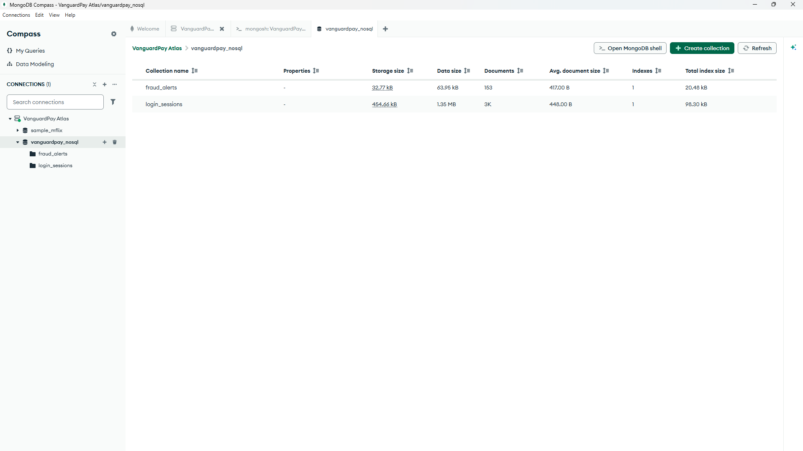
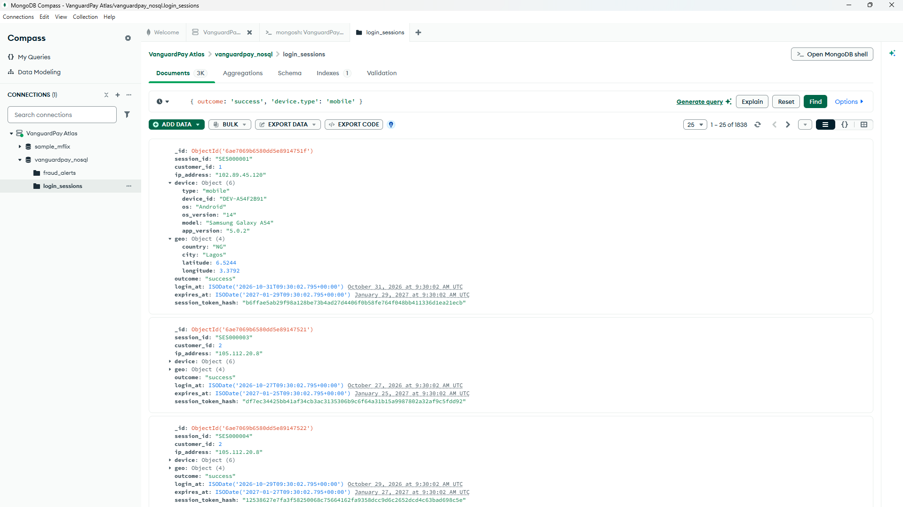
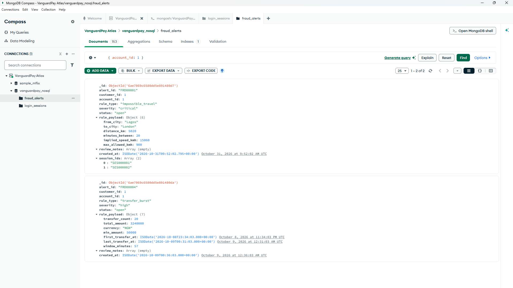
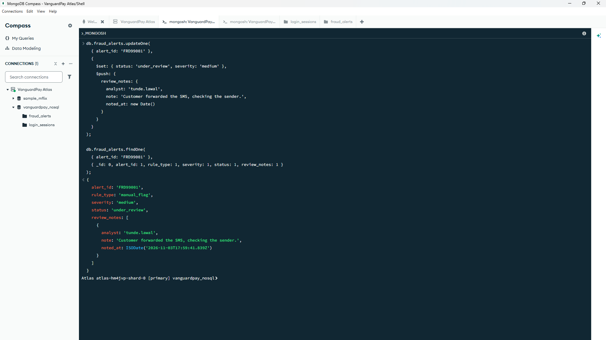
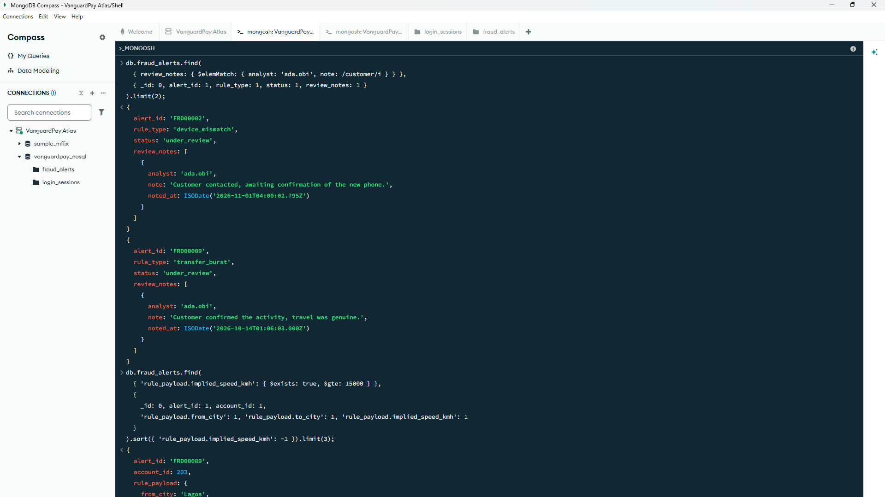
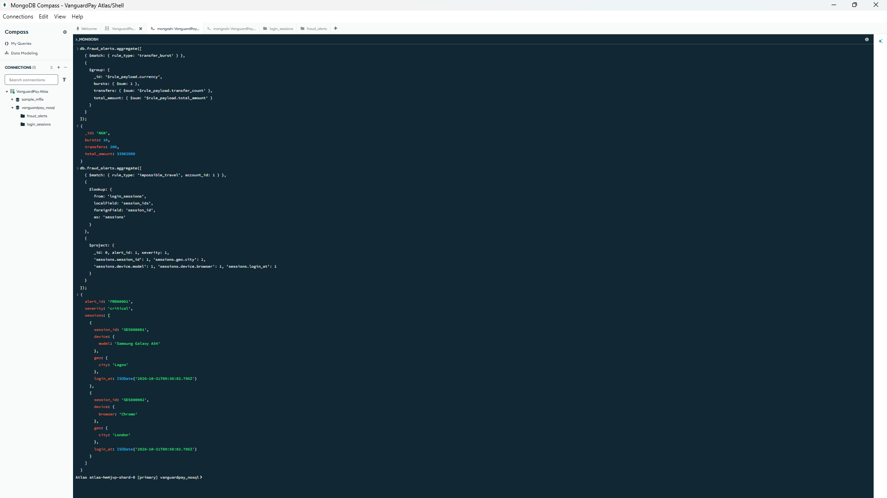
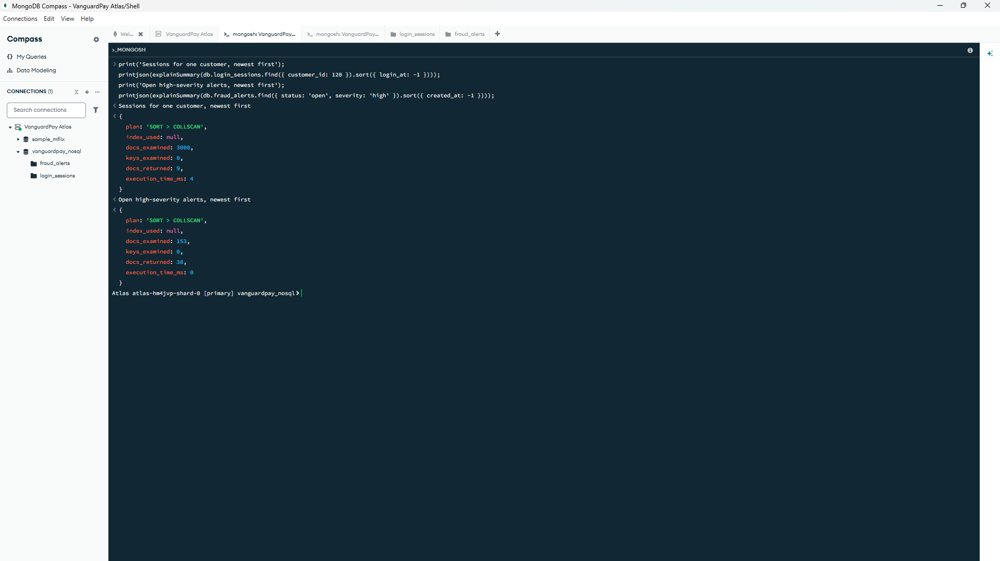
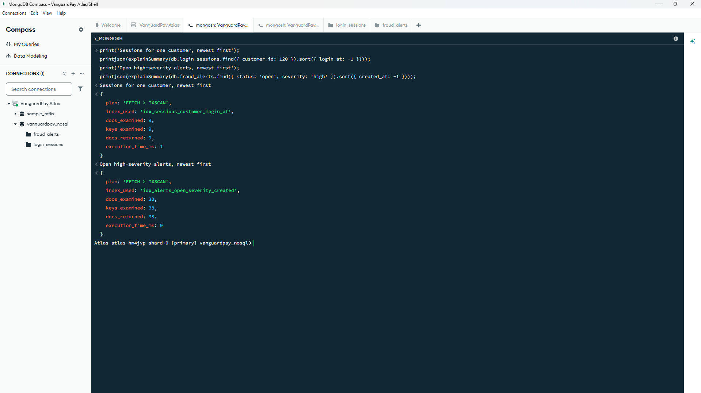
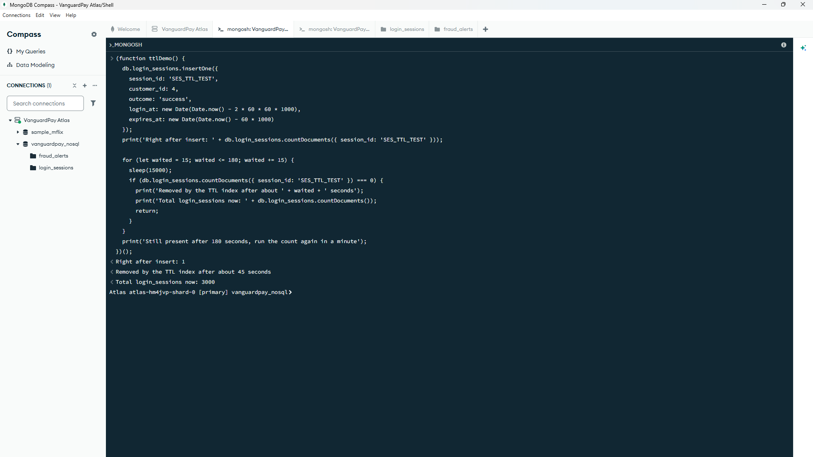

# Portfolio 4: NoSQL and Advanced Data Models

**Case study:** VanguardPay

**Database system:** MongoDB Atlas M0, managed with MongoDB Compass

## Overview

In this portolio, I implemented the semi-structured operational and security data store for VanguardPay in MongoDB (`vanguardpay_nosql`), complementing the relational PostgreSQL core ledger built in Portfolios 1 to 3.

I designed two collections to model high-volume, variable-structure security telemetry: `login_sessions` (authentication events with embedded device and geolocation metadata) and `fraud_alerts` (flagged risk events whose rule payloads vary polymorphically by detection rule). The implementation is divided into two scripts: `seed_documents.js` (collection modelling and data seeding) and `queries_and_indexes.js` (CRUD operations, nested queries, aggregation pipelines, index optimisation with `explain('executionStats')`, and TTL expiration).

## Stage 1: Data Model and Seeding (`seed_documents.js`)

### Collections

**`login_sessions`** stores one document per login attempt.

| Field | Type | Notes |
|---|---|---|
| `session_id` | string | Unique identifier (e.g., `SES000001`) |
| `customer_id` | number |References PostgreSQL `customers.customer_id` (`1` to `500`) |
| `ip_address` | string |Source IPv4 address of the login attempt |
| `device` | embedded object | Mobile: `type`, `device_id`, `os`, `os_version`, `model`, `app_version`. Web: `type`, `device_id`, `os`, `browser`, `browser_version` |
| `geo` | embedded object | `country`, `city`, `latitude`, `longitude` |
| `outcome` | string | `success`, `failed`, or `blocked` |
| `session_token_hash` | string | Present on successful logins only (64-character hash; raw tokens are never stored) |
| `failure_reason` | string | Failed or blocked logins only |
| `login_at` | date | When the login happened |
| `expires_at` | date | Set to 90 days after `login_at` for automated TTL expiration |

**`fraud_alerts`** stores one document per flagged event.

| Field | Type | Notes |
|---|---|---|
| `alert_id` | string | Unique identifier (e.g., `FRD00001`) |
| `customer_id` | number | References PostgreSQL `customers.customer_id` |
| `account_id` | number | References PostgreSQL `accounts.account_id` |
| `rule_type` | string | `transfer_burst`, `impossible_travel`, `device_mismatch`, or `failed_login_streak` |
| `severity` | string | `low`, `medium`, `high`, or `critical` |
| `status` | string | `open`, `under_review`, `confirmed_fraud`, or `false_positive` |
| `rule_payload` | embedded object | Polymorphic sub-document whose structure depends on `rule_type` |
| `session_ids` | array of strings | Associated `login_sessions.session_id` values (omitted on `transfer_burst` alerts) |
| `review_notes` | array of objects | Analyst investigation trail (`analyst`, `note`, `noted_at`) |
| `created_at` | date | Timestamp when the alert was raised |
| `resolved_at` | date | Present only on `confirmed_fraud` and `false_positive` alerts |

The `rule_payload` sub-document adapts its schema to each detection rule without requiring nullable columns across unrelated alert types:

| `rule_type` | Fields in `rule_payload` |
|---|---|
| `transfer_burst` | `transfer_count`, `total_amount`, `currency`, `min_amount`, `first_transfer_at`, `last_transfer_at`, `window_minutes` |
| `impossible_travel` | `from_city`, `to_city`, `distance_km`, `minutes_between`, `implied_speed_kmh`, `max_allowed_kmh` |
| `device_mismatch` | `known_device_id`, `seen_device_id`, `new_device_first_seen`, plus device details such as `seen_device_model` or `seen_device_type` |
| `failed_login_streak` | `failed_attempts`, `window_minutes`, `ended_in`, `ip_address` |

Two alerts for `account_id` 1, trimmed for space (`_id` and some fields omitted, dates shown as text):

```json
{
  "alert_id": "FRD00001",
  "customer_id": 1,
  "account_id": 1,
  "rule_type": "impossible_travel",
  "severity": "critical",
  "status": "open",
  "rule_payload": {
    "from_city": "Lagos",
    "to_city": "London",
    "distance_km": 5020,
    "minutes_between": 20,
    "implied_speed_kmh": 15060,
    "max_allowed_kmh": 900
  },
  "session_ids": ["SES000001", "SES000002"],
  "review_notes": []
}
```

```json
{
  "alert_id": "FRD00004",
  "customer_id": 1,
  "account_id": 1,
  "rule_type": "transfer_burst",
  "severity": "high",
  "status": "open",
  "rule_payload": {
    "transfer_count": 20,
    "total_amount": 3240000,
    "currency": "NGN",
    "min_amount": 50000,
    "first_transfer_at": "2026-10-09T00:34:03+01:00",
    "last_transfer_at": "2026-10-09T01:31:03+01:00",
    "window_minutes": 57
  },
  "review_notes": [],
  "created_at": "2026-10-09T01:36:03+01:00"
}
```

### Burst data from PostgreSQL

The `transfer_burst` alerts carry data from Portfolio 2. I ran this query in pgAdmin 4 to summarise the suspicious transfer bursts (Key Operation 8) for accounts 1 to 10, then pasted the JSON result into the `burstData` line of `seed_documents.js`.

```sql
WITH big_transfers AS (
    SELECT source_account_id AS account_id, created_at, amount
    FROM transactions
    WHERE transaction_type = 'transfer'
      AND status = 'successful'
      AND amount >= 50000
      AND source_account_id BETWEEN 1 AND 10
),
burst_rows AS (
    SELECT b.*
    FROM big_transfers b
    WHERE (SELECT count(*)
           FROM big_transfers x
           WHERE x.account_id = b.account_id
             AND x.created_at BETWEEN b.created_at - interval '1 hour'
                                  AND b.created_at + interval '1 hour') >= 10
)
SELECT json_agg(row_to_json(s) ORDER BY s.account_id) AS burst_json
FROM (
    SELECT account_id,
           count(*)        AS transfer_count,
           sum(amount)     AS total_amount,
           min(created_at) AS first_transfer_at,
           max(created_at) AS last_transfer_at
    FROM burst_rows
    GROUP BY account_id
) s;
```

The query returned 10 objects, one per account. Each shows 20 transfers inside a 57-minute window, and the ten totals add up to `33,982,000.00` NGN across `200` transfers.

### What I built

- I wrote `seed_documents.js` to create `login_sessions` (3,000 documents) and `fraud_alerts` (153 documents) and to reload both collections each time it runs.
- The 3,000 sessions are 12 planted sessions for customers 1 to 3, plus random sessions for customers 4 to 500 spread over the last 30 days. About 85% succeed, 12% fail, and 3% are blocked, and about 5% come from outside Nigeria.
- The 153 alerts are 3 planted alerts for the test accounts, 10 `transfer_burst` alerts from the pgAdmin results, and 140 random alerts for customers 4 to 500.
- I set every `expires_at` to 90 days after the login, so no seeded session expires while I work.

| Test account | Customer | Planted scenario | Alert |
|---|---|---|---|
| A (`account_id` 1) | 1 | Login from Lagos, then from London 20 minutes later on a different device | `impossible_travel`, `critical`, `open` |
| B (`account_id` 2) | 2 | Three logins on a known iPhone, then a login from a new Android phone in Abuja | `device_mismatch`, `medium`, `under_review` with one analyst note |
| C (`account_id` 3) | 3 | Five failed logins in five minutes, then a successful login | `failed_login_streak`, `medium`, `open` |

Accounts 1 to 3 are also in the burst set, so each has a `transfer_burst` alert as well.



*The `vanguardpay_nosql` database in Compass, showing `login_sessions` and `fraud_alerts` with their document counts.*



*One `login_sessions` document with the nested `device` and `geo` objects.*



*The `impossible_travel` and `transfer_burst` alerts for `account_id` 1, with two different `rule_payload` shapes in the same collection.*

### Results

- `login_sessions` holds 3,000 documents, each with its `device` and `geo` embedded, and `fraud_alerts` holds 153 documents.
- Four different `rule_payload` shapes sit side by side in one collection with no empty columns.
- The pgAdmin burst query supplied 10 accounts with 20 transfers each, totalling `33,982,000.00` NGN across `200` transfers.
- Every record links back to PostgreSQL through `customer_id` or `account_id`.

## Stage 2: Queries, Aggregations and Indexes (`queries_and_indexes.js`)

I ran `queries_and_indexes.js` one numbered section at a time in the Compass `mongosh` shell.

### CRUD operations

I ran the four CRUD operations on `fraud_alerts` in sections 1 to 4:

- **Create:** `insertOne` added a manual alert (`FRD99001`) for `account_id` 2 with a new `rule_type` of `manual_flag` and a payload shape no other alert has. The collection accepted it with no schema change.
- **Update one:** `updateOne` used `$set` to change `status` to `under_review` and `severity` to `medium`, and `$push` to add an analyst note to `review_notes`. I read the document back to confirm both changes.
- **Update many:** `updateMany` moved every low-severity `open` alert older than 14 days to `false_positive` and stamped `resolved_at` with `$currentDate`. It matched and modified 10 documents (`matchedCount: 10`, `modifiedCount: 10`).
- **Delete:** `deleteMany` removed the `manual_flag` alert, and `countDocuments()` returned 153 again.



*`updateOne` with `$set` and `$push`, followed by the alert read back with the new note in `review_notes`.*

### Nested queries

In section 5, I ran three queries that reach inside nested objects and arrays:

- **Dot notation:** `outcome: 'success'`, `'device.type': 'mobile'`, and `'geo.country': { $ne: 'NG' }` found successful mobile logins from outside Nigeria, with a projection of `device.model` and `geo.city`.
- **`$elemMatch`:** `review_notes: { $elemMatch: { analyst: 'ada.obi', note: /customer/i } }` found alerts where one single note was written by that analyst and mentions the customer. `$elemMatch` makes both conditions apply to the same array item.
- **`$exists` on payload fields:** `'rule_payload.implied_speed_kmh': { $exists: true, $gte: 15000 }` found alerts that carry an implied speed field, which only `impossible_travel` payloads have.



*Nested queries on `review_notes` with `$elemMatch` and on payload fields with `$exists`.*

### Aggregations

In section 6, I ran four aggregation pipelines.

**6a. Failed logins per country** (`$match`, `$group`, `$sort` on `login_sessions`):

| Country | Failed logins |
|---|---|
| NG | 358 |
| GH | 10 |
| GB | 9 |
| AE | 4 |

About 94% of the 381 failed logins come from Nigeria, so the few foreign failures stand out.

**6b. Alerts by rule type and severity** (`$group` on a two-field `_id`):

| Rule type | Severity | Alerts |
|---|---|---|
| `device_mismatch` | low | 25 |
| `device_mismatch` | medium | 18 |
| `failed_login_streak` | high | 25 |
| `failed_login_streak` | medium | 23 |
| `impossible_travel` | critical | 22 |
| `impossible_travel` | high | 30 |
| `transfer_burst` | high | 10 |

The groups add up to the 153 alerts in the collection.

**6c. Transfer burst totals.** I summed `rule_payload.transfer_count` and `rule_payload.total_amount` across the 10 `transfer_burst` alerts to cross-check MongoDB against PostgreSQL. The ten pgAdmin burst totals add up to `33,982,000.00` NGN over 200 transfers, so the MongoDB aggregation matches it.

**6d. `$lookup` join.** I joined the `impossible_travel` alert for `account_id` 1 to `login_sessions` through `session_ids` and `session_id`. The result shows the Lagos and London logins inside the alert, 20 minutes apart.



*The transfer burst totals (6c) and the `$lookup` join from an alert to its login sessions (6d).*

### Indexes

In section 8, I created five indexes:

| Index | Collection | Type | Keys | Purpose |
|---|---|---|---|---|
| `idx_sessions_customer_login_at` | `login_sessions` | Compound | `customer_id` ascending, `login_at` descending | A customer's login history, newest first |
| `uq_sessions_session_id` | `login_sessions` | Unique | `session_id` | One document per session, and a fast target for `$lookup` |
| `ttl_sessions_expires_at` | `login_sessions` | TTL (`expireAfterSeconds: 0`) | `expires_at` | Removes sessions automatically after they expire |
| `uq_alerts_alert_id` | `fraud_alerts` | Unique | `alert_id` | One document per alert, and fast lookups for updates |
| `idx_alerts_open_severity_created` | `fraud_alerts` | Partial (`status: 'open'`) | `severity` ascending, `created_at` descending | Open alerts by severity, newest first |

### Execution plans with `explain('executionStats')`

I evaluated two operational queries before and after index creation using `explain('executionStats')`:

| Query | Stage | Plan | Documents examined | Keys examined | Documents returned | Time (ms) |
|---|---|---|---|---|---|---|
| Sessions for one customer, newest first | Before | `SORT > COLLSCAN` | 3,000 | 0 | 9 | 4 |
| Sessions for one customer, newest first | After | `FETCH > IXSCAN` | 9 | 9 | 9 | 1 |
| Open high-severity alerts, newest first | Before | `SORT > COLLSCAN` | 153 | 0 | 38 | 0 |
| Open high-severity alerts, newest first | After | `FETCH > IXSCAN` | 38 | 38 | 38 | 0 |

On the customer session query, `idx_sessions_customer_login_at` reduced `totalDocsExamined` from 3,000 to 9 (a 99.7% reduction), eliminated the in-memory `SORT` stage because the index key order matches the sort specification, and reduced execution time from 4 ms to 1 ms. On the open alerts query, the partial index reduced `totalDocsExamined` from 153 to 38 (a 75.2% reduction); execution time remained under 1 ms due to the small collection size, making documents examined the primary performance indicator.



*`explain` summaries before indexing. Both queries use `SORT > COLLSCAN` and read every document.*



*`explain` summaries after indexing. Both queries use `FETCH > IXSCAN` and examine only matching documents.*

### TTL index demonstration

In section 10, I inserted a test session `(SES_TTL_DEMO)` with `expires_at` set one minute in the past. Immediately after insertion, `countDocuments({ session_id: 'SES_TTL_DEMO' })` returned 1. After MongoDB's background TTL monitor completed its next 60-second pass (~45 seconds later), the expired document was automatically removed, returning `login_sessions` to 3,000 documents.



*The expired test session counted as 1 straight after insertion, then removed by the TTL index after about 45 seconds.*

### Results

- `insertOne`, `updateOne`, `updateMany`, and `deleteMany` all worked on `fraud_alerts`. The `manual_flag` alert needed no schema change, `updateMany` closed 10 stale low-severity alerts, and the collection returned to 153 documents.
- Dot notation, `$elemMatch`, and `$exists` reached inside `device`, `geo`, `review_notes`, and `rule_payload`.
- 358 of the 381 failed logins came from Nigeria, and the rule type and severity groups added up to all 153 alerts.
- The compound index cut documents examined for the customer session query from 3,000 to 9 and removed the `SORT` stage. The partial index cut the open alerts query from 153 documents examined to 38.
- The TTL index removed the expired test session after about 45 seconds, and the seeded sessions stayed untouched.

## Explanation of Suitability

### Why documents fit login sessions

Each login session represents an immutable, self-contained event where `device` and `geo` attributes are always read together with the parent session. Embedding these objects allows a single document read to return the full context without multi-table joins, while accommodating structural differences across records:

- Mobile sessions record `model`, `os_version`, and `app_version`, while web sessions record `browser` and `browser_version`.
- Successful sessions store `session_token_hash`, while failed and blocked logins store `failure_reason`.

In a relational schema, this requires either wide tables with nullable columns or separate child tables joined on every read. Additionally, MongoDB's native TTL index on `expires_at` automates 90-day session retention cleanup inside the storage engine, whereas PostgreSQL requires an external scheduled job (`pg_cron` or application worker) to purge expired rows.

### Why documents fit polymorphic fraud alerts

Each fraud detection rule generates a distinct diagnostic structure (`transfer_burst` tracks transfer counts and NGN totals; `impossible_travel` tracks city pairs and implied speed; `device_mismatch` tracks device fingerprints). Storing these in MongoDB allows each alert document to hold only the attributes relevant to its rule type, and adding a new rule (`manual_flag`) required no `ALTER TABLE` migration. Embedding `review_notes` as an array of sub-documents also keeps the investigation audit trail co-located with the alert rather than splitting notes into a separate relational child table.

### MongoDB, PostgreSQL tables and PostgreSQL `JSONB` compared

| Criterion | MongoDB documents | PostgreSQL relational tables | PostgreSQL `JSONB` |
|---|---|---|---|
| Flexible shape | Each document can have its own fields, with no schema change | Fixed columns, so variations need nulls or extra tables | Flexible inside the `JSONB` column, while the other columns stay fixed |
| Nested data | Stored natively and queried with dot notation | Needs child tables and joins | Stored natively in the column and queried with `->` and `->>` |
| Updating one nested value | `$set` and `$push` change a single field or array item | `UPDATE` or `INSERT` on the relevant table or child table | Rewrites the `JSONB` value, which writes a new version of the whole row |
| Referential integrity | None across collections or databases, so the application must enforce it | Foreign keys, `CHECK` constraints, and `ON DELETE RESTRICT` | Foreign keys on ordinary columns such as `customer_id`, but none for keys inside the `JSONB` |
| Joins | `$lookup` at query time | Standard SQL `JOIN` | Standard SQL `JOIN` to other tables |
| Automatic expiry | Built-in TTL index | None built in, so a scheduled delete job is needed | None built in, so a scheduled delete job is needed |
| Indexing nested fields | Index on a dot-notation path, such as `device.type` | B-tree on ordinary columns | GIN index on the `JSONB` column |
| Fit for VanguardPay | Best for sessions and alerts | Best for money, balances, and the ledger | A reasonable choice when one database must hold everything |

### Why the Financial Ledger Remains in PostgreSQL

Balances, transfers, and reversals depend on enforced rules: `CHECK (balance >= 0)`, foreign keys, and the row locking I tested in Portfolio 3. MongoDB does support multi-document transactions, but the relational constraints in Portfolio 1 protect money better. The two systems also fit the work differently. PostgreSQL holds what must always be exactly right, and MongoDB holds records that are flexible and short-lived.

### Trade-off: application-level foreign keys

Because MongoDB does not enforce cross-collection or cross-database foreign keys, customer_id and account_id are stored as unvalidated integer references. In Portfolio 1, I used `ON DELETE RESTRICT` so a customer with accounts could not be deleted. In this design, deleting a customer in PostgreSQL leaves orphaned sessions and alerts in MongoDB. The same applies inside MongoDB: `session_ids` in an alert point to `login_sessions.session_id`, and `$lookup` only joins at query time. To keep the references consistent, I seeded the IDs from the same customer and account numbering as `seed_large_data.sql`. The application layer then has to:

- check that `customer_id` and `account_id` exist in PostgreSQL before inserting a document;
- clean up or archive related documents when a customer is closed;
- run periodic checks for orphaned documents, in the same spirit as the balance audit from Portfolio 3.

## Technical Reflection

### Key Insights and Trade-offs

- **Embedding Keeps Related Data Together:** Putting `device`, `geo`, and `review_notes` inside their parent documents means one read returns everything an analyst needs. The cost is that the same device information is repeated across sessions, where a relational design would store it once.
- **Flexible Payloads vs. Schema Guarantees:** The `manual_flag` alert with a new payload shape went in without a migration. The cost is that the database no longer guards the shape, so a misspelt field name would be accepted silently.
- **Referential Integrity Moves to the Application:** MongoDB cannot check that an `account_id` exists in PostgreSQL, so the application has to. This is the main reason balances and transfers stay in PostgreSQL, where `CHECK` constraints and foreign keys protect them.
- **Compound Indexes Serve Filter and Sort Together:** The index on `customer_id` and `login_at` cut documents examined from 3,000 to 9 and removed the `SORT` stage. The alert query improved from 153 to 38 documents examined at the same 0 ms, so documents examined is a more honest measure than time on a small collection.
- **Partial Indexes Are Smaller but Conditional:** `idx_alerts_open_severity_created` only covers open alerts, so a query has to include `status: 'open'` to use it. In return, closed alerts add nothing to the index.
- **TTL Cleanup Is Convenient but Not Instant:** The expired test session disappeared after about 45 seconds, so TTL suits retention cleanup, not exact deadlines. Setting `expires_at` 90 days after each login kept my seeded sessions safe.
- **Cross-Checking Against PostgreSQL Is the Verification Standard:** The pgAdmin burst totals (`33,982,000.00` NGN over 200 transfers) gave me a fixed figure to check the MongoDB aggregation against, the same role the balance audit played in Portfolio 3. The seed script also validates its input before it drops any data.

## AI Use Declaration

**AI tool used:** Claude (Anthropic).

**What I used it for:** I used Claude as a learning partner to review document modelling patterns, aggregation pipeline stages, TTL and partial index syntax, and `explain('executionStats')` interpretation, as well as to assist with `mongosh` scripting and documentation structure.

**How I reviewed, corrected, tested and verified the output:** I executed every script section myself in MongoDB Compass and pgAdmin 4, and I captured all 9 screenshots from my own runs. Every document count, aggregation output, and execution plan metric in this README was recorded directly from my live `mongosh` and PostgreSQL outputs. I cross-checked the results across both systems, verifying that the MongoDB `transfer_burst` aggregation matched the `33,982,000.00` NGN and `200` transfers extracted from PostgreSQL, and that the grouped alert counts reconciled to all `153` documents.

I remain responsible for the accuracy, originality and understanding of everything in this portfolio.
