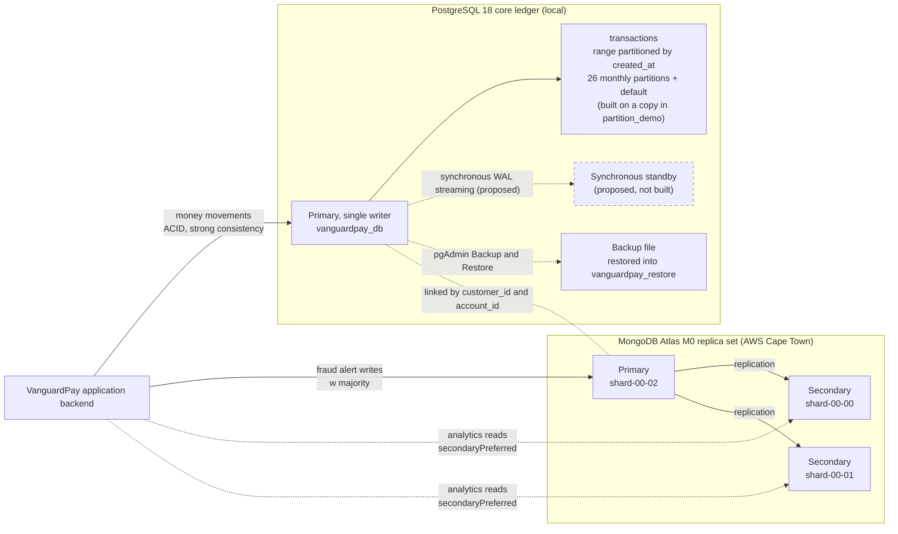

# Portfolio 5: Distributed and Cloud Databases

## Overview

In this portfolio, I took VanguardPay from one local database to a distributed design and tested parts of it. The work has two stages that follow the two database systems in the case study:

- **Stage 1 (PostgreSQL 18, pgAdmin 4):** I range-partitioned a copy of the `transactions` table, compared a pruned query against an unpruned one with `EXPLAIN (ANALYZE, BUFFERS)`, inspected the server's replication settings, and backed up and restored the whole database into `vanguardpay_restore`.
- **Stage 2 (MongoDB Atlas M0, Compass):** I inspected the 3-node replica set, compared write concerns `w: 1`, `"majority"`, `w: 3` and `w: 4`, compared read preferences, and exported `fraud_alerts` from Compass as a JSON backup and restored it into a test collection.

I kept the money ledger in PostgreSQL because it needs strong consistency and `ACID` transactions. I kept login sessions and fraud alerts in MongoDB because they are flexible documents where read scaling and availability matter more.

### What I Built and What I Designed

## How I Ran It

**Stage 1 in pgAdmin 4 (PostgreSQL 18.6):**

1. I ran `partitioning.sql` in the Query Tool one numbered section at a time, because pgAdmin only shows the result of the last statement in a script.
2. I ran `replication_and_backup_checks.sql` section 1 for the replication settings.
3. I right-clicked `vanguardpay_db`, chose **Backup...**, and saved a **Custom** format file named `vanguardpay_p5.backup` outside my repository, because it holds a full copy of the data.
4. I created an empty database named `vanguardpay_restore`, right-clicked it, chose **Restore...**, and restored the file into it.
5. I ran section 2 of `replication_and_backup_checks.sql` on `vanguardpay_db` and then on `vanguardpay_restore`, and compared the results.

**Stage 2 in MongoDB Compass (`mongosh` tab, Atlas M0):**

1. I pasted blocks 1, 2 and 3 of `replica_set_tests.js` into the shell one at a time and captured each output.
2. I used Compass **Export** on `vanguardpay_nosql.fraud_alerts` to save `fraud_alerts_backup.json`.
3. I imported that file into a new collection, `fraud_alerts_restore_test`, ran block 4 to compare it with the original, and then dropped the test collection.

## Architecture

The diagram shows the hybrid design. Solid boxes are what I built. The dashed box is the standby I designed but did not build.

PostgreSQL stays the single writer for every naira that moves. MongoDB has no foreign keys, so the application enforces the `customer_id` and `account_id` links between the two systems, as I documented in Portfolio 4.

---

## Stage 1: PostgreSQL 18 (pgAdmin 4)

### 1.1 Range Partitioning on a Copy of `transactions`

I partitioned a copy of the ledger instead of the live table. A partitioned table's primary key must include the partition column, so the key becomes `(transaction_id, created_at)`. The foreign key from `transaction_logs` points at `transaction_id` alone, so partitioning `public.transactions` would have broken Portfolios 1 to 3. I built `partition_demo.transactions` in a separate schema and left the live ledger untouched.

In `partitioning.sql`, I:

- created the table with `PARTITION BY RANGE (created_at)` and kept the same `CHECK` constraints and foreign keys to `public.accounts`;
- wrote a `DO` block that reads the earliest and latest `created_at` and creates one monthly partition for every month in between, so I did not hard-code any dates;
- added a default partition for any row outside the monthly ranges;
- loaded all rows from `public.transactions` and ran `ANALYZE`.

The ledger spans about two years, not one. Step 1 of the script returned an earliest date of `2024-10-26` and a latest of `2026-10-30`, because the seed script dates each opening deposit just after its account opened. The `DO` block therefore created 26 monthly partitions, from `transactions_2024_10` to `transactions_2026_11`, plus `transactions_default`.

| Check | `public.transactions` | `partition_demo.transactions` |
|---|---|---|
| Row count | 20,012 | 20,012 |
| Total amount (NGN) | 2,969,904,160.00 | 2,969,904,160.00 |
| Rows in the default partition | not applicable | 0 |

All 20,012 rows landed in monthly partitions. The early months are small, with 1 to 68 rows each, because they hold only opening deposits. February 2026 has 331 rows, and March to October 2026 hold between 2,024 and 2,457 rows each. November 2026 and the default partition are empty.

*Figure 1: The 27 partitions of `partition_demo.transactions`, with their bounds and row counts. The default partition holds 0 rows.*

### 1.2 Partition Pruning with `EXPLAIN (ANALYZE, BUFFERS)`

I ran the same aggregate, `count(*)` and `sum(amount)`, twice. The first query filtered on October 2026. The second had no date filter.

| Measure | One-month filter | No filter |
|---|---|---|
| Partitions read | 1 of 27 | 27 of 27 |
| Rows read by the scan | 2,024 | 20,012 |
| Shared buffer hits | 28 | 282 |
| Execution time | 0.459 ms | 4.718 ms |
| Planning time | 0.381 ms | 0.919 ms |

With the date filter, the plan scanned only `transactions_2026_10` and skipped the other 26 partitions. That is about 10 times fewer buffer hits and about 10 times less execution time. The table has only 20,012 rows, so the absolute times are tiny. I treat the buffer-hit ratio as the reliable result, because it comes from how many partitions the plan reads and will grow with the table.

*Figure 2: The filtered plan scans one partition (28 buffer hits), and the unfiltered plan appends all 27 (282 buffer hits).*

### 1.3 Replication Catalog Check

I ran section 1 of `replication_and_backup_checks.sql` to see what my server has enabled for replication.

| Check | Value | What it means |
|---|---|---|
| `server_version` | 18.6 | The PostgreSQL version I ran |
| `is_standby` | false | This server is a primary |
| `wal_level` | replica | The write-ahead log carries enough detail for physical streaming replication |
| `max_wal_senders` | 10 | Up to 10 standby or backup connections can stream the log |
| `max_replication_slots` | 10 | Up to 10 replication slots can be created |
| `replication_slots` | 0 | No slot exists yet |
| `connected_standbys` | 0 | Nothing is streaming from this server |
| `hot_standby` | on | A standby built from this configuration could answer read-only queries |
| `synchronous_commit` | on | A commit waits for its log to be flushed, and for any named synchronous standby |
| `synchronous_standby_names` | empty | No synchronous standby is configured |
| `archive_mode` | off | Finished log files are not archived, so point-in-time recovery is not possible |
| `current_wal_lsn` | 0/3507830 | The current write position in the log, in file `000000010000000000000003` |

The server is ready to act as a primary, but it is a single server. I have no standby, so replication here is a design, not a running setup. The result I act on is `archive_mode = off`: my only recovery path is the logical backup in section 1.4, with no point-in-time recovery.

*Figure 3: Replication settings and WAL status of my PostgreSQL 18.6 server. `connected_standbys` and `replication_slots` are both 0.*

### 1.4 Backup and Restore Verification

I used the pgAdmin Backup dialog, which runs `pg_dump`, to save `vanguardpay_db` in Custom format. I created an empty `vanguardpay_restore` database and used the Restore dialog, which runs `pg_restore`, to rebuild it. I then ran the same verification query on both databases.

*Figure 4: The pgAdmin Process Watcher after the backup of `vanguardpay_db` finished.*

| Check | `vanguardpay_db` | `vanguardpay_restore` | Match |
|---|---|---|---|
| `customers` | 500 | 500 | Yes |
| `accounts` | 800 | 800 | Yes |
| `transactions` | 20,012 | 20,012 | Yes |
| `transaction_logs` | 27,727 | 27,727 | Yes |
| `beneficiaries` | 1,406 | 1,406 | Yes |
| `partition_demo_transactions` | 20,012 | 20,012 | Yes |
| `total_balance_ngn` | 952,708,440.00 | 952,708,440.00 | Yes |
| `accounts_checked` | 800 | 800 | Yes |
| `accounts_out_of_balance` | 0 | 0 | Yes |

Every count and the total balance match, and the balance audit from Key Operation 6 still finds 0 of 800 accounts out of balance in the restored copy. The `partition_demo` schema and the `v_balance_audit` view also came across, because the verification query reads both.

*Figure 5: The verification query run on `vanguardpay_restore`. All nine results match the original.*

---

## Stage 2: MongoDB Atlas (Compass)

### 2.1 Cluster and Replica Set Topology

My free Atlas cluster is a 3-node replica set. The cluster card shows the following.

| Item | Value |
|---|---|
| Version | 8.0.36 |
| Region | AWS / Cape Town (`af-south-1`) |
| Type | Replica Set - 3 nodes |
| Disaster Recovery | Backups Inactive |

*Figure 6: The Atlas cluster card for my M0 cluster. It shows a 3-node replica set in one region, with backups inactive.*

I ran `db.hello()` in the `mongosh` shell to read the topology.

| Node | Role |
|---|---|
| `ac-kpnm5qz-shard-00-02...:27017` | Primary (the node I was connected to) |
| `ac-kpnm5qz-shard-00-00...:27017` | Secondary |
| `ac-kpnm5qz-shard-00-01...:27017` | Secondary |

The replica set is named `atlas-hm4jvp-shard-0`, and `is_writable_primary` was `true` on the node I connected to. There is one primary that takes writes and two secondaries that copy them.

*Figure 7: The replica set name, the primary and the two secondaries from `db.hello()`.*

### 2.2 Write Concern

Write concern is how many nodes must confirm a write before MongoDB reports success. I inserted 20 documents into a test collection under each setting, and then tried one write that asked for more confirmations than the cluster has nodes.

| Test | Write concern | Inserts | Acknowledged | Total time | Average per insert |
|---|---|---|---|---|---|
| `w_1` | `{ w: 1 }` | 20 | 20 | 2,111 ms | 105.6 ms |
| `w_majority` | `{ w: "majority" }` | 20 | 20 | 2,187 ms | 109.4 ms |
| `w_3_all_nodes` | `{ w: 3 }` | 20 | 20 | 2,315 ms | 115.8 ms |

Each stronger setting added a few milliseconds: about 4 ms for `"majority"` and about 10 ms for all three nodes. This is one run of 20 inserts, so I read it as a direction and not a precise benchmark. Most of the 105 ms baseline is probably the network round trip between Lagos and the Cape Town cluster, not replication cost.

For the `w: 4` test, I used `{ w: 4, wtimeout: 5000 }`. M0 has no way to switch a node off, so this request for four confirmations from three nodes stands in for "not enough nodes reachable".

| Result | Value |
|---|---|
| Error type | `MongoWriteConcernError` |
| Code | 100 (`UnsatisfiableWriteConcern`) |
| Message | Not enough data-bearing nodes |
| `w_4_impossible` documents stored afterwards | 1 |

The server refused to report success for a guarantee it could not give. It did not undo the write, though. The document was still on the primary when I read it back. A failed write concern in MongoDB tells the client the guarantee failed, but it does not roll the write back. A failed transaction in PostgreSQL does roll back, as I showed in Portfolio 3.

*Figure 8: Timings for `w: 1`, `"majority"` and `w: 3`, then the `w: 4` error and the per-test document counts.*

### 2.3 Read Preference

Read preference decides which node answers a read. I used `explain('executionStats')` on an open-alerts query against `fraud_alerts` and read the node name from `serverInfo`.

| Read preference | Node that answered | Role |
|---|---|---|
| `primary` | `ac-kpnm5qz-shard-00-02...` | Primary |
| `secondaryPreferred` | `ac-kpnm5qz-shard-00-01...` | Secondary |
| `secondary` | `ac-kpnm5qz-shard-00-00...` | Secondary |

The `secondary` read left the primary, which is what I expected. I also ran 10 reads with `secondaryPreferred`, and they split evenly, 5 on `shard-00-00` and 5 on `shard-00-01`. Secondary reads therefore spread the load across both copies.

The cost of a secondary read is that it can lag behind the primary. I tested that with a stale-read probe: 20 times, I wrote one document with `w: 1` and immediately read it back from a secondary. All 20 reads found the document, so 0 were stale. That does not prove lag cannot happen, because Atlas replication lag is usually only a few milliseconds and 20 tries is a small sample. The guarantee stays eventual consistency.

*Figure 9: The node that answered under each read preference, the 5/5 split across the secondaries, and the stale-read probe result of 0 of 20.*

### 2.4 Compass JSON Backup and Restore

M0 has no cloud backup, so I used Compass to export the whole `fraud_alerts` collection to `fraud_alerts_backup.json`. I imported that file into a new collection, `fraud_alerts_restore_test`, and ran block 4 to compare the two. I checked that `created_at` came back as a real date and not a string, because a JSON round trip can lose types.

| Check | `fraud_alerts` | `fraud_alerts_restore_test` |
|---|---|---|
| Documents | 153 | 153 |
| `created_at` stored as a date | 153 | 153 |
| `device_mismatch` alerts | 43 | 43 |
| `failed_login_streak` alerts | 48 | 48 |
| `impossible_travel` alerts | 52 | 52 |
| `transfer_burst` alerts | 10 | 10 |

The script printed `Restored copy matches the original: true`. I dropped the test collection after the check.

*Figure 10: Block 4 compares `fraud_alerts` with the restored test collection. Counts, date types and rule-type totals all match.*

---

## Architectural Design and Justification

### CAP Theorem

| Component | Choice | Behaviour when the network splits |
|---|---|---|
| PostgreSQL ledger with a synchronous standby (proposed) | Consistency (CP) | A commit waits for the standby, so writes stall instead of the two copies diverging |
| MongoDB `fraud_alerts` writes with `w: "majority"` | Consistency (CP) | Only the side holding a majority of nodes can elect a primary and accept majority-acknowledged writes |
| MongoDB analytics reads with `secondaryPreferred` | Availability, eventual consistency | A secondary answers even if it is a few moments behind |

I chose consistency for the ledger because a wrong balance is worse than a short delay, and every naira must be traceable. In my local setup this is trivially true, because there is only one server. With a standby, I would set `synchronous_commit = on` and name the standby in `synchronous_standby_names`, so a commit is only reported once the standby has it. With one standby, losing it would stall all writes. I would use a quorum such as `ANY 1 (standby_a, standby_b)` with two standbys, so one standby can fail without stopping the ledger. I did not apply this configuration on my single server.

For fraud alert writes, I would set `w: "majority"` explicitly in the application. Atlas connection strings normally include it, but a stated setting is easier to audit. My `w: 4` test is the closest evidence I can produce on M0: the server enforces the number of confirmations I ask for and refuses to report a guarantee it cannot meet. I cannot split the network on M0, so I did not test partition behaviour directly.

For analytics reads, such as failed logins per country, a slightly old answer is acceptable and spreading load across secondaries is useful. I would never use `secondaryPreferred` for a balance decision. Those decisions stay in PostgreSQL.

### Sharding and Partitioning Design

**PostgreSQL: range partitioning on `created_at`.** I partitioned `transactions` by month because most of its queries are date-bound. Account statements (Key Operation 7), audits, and fraud checks all ask for a time window, and the pruning test showed a one-month query reading 1 of 27 partitions. Old months can also be detached or archived on their own. The trade-offs are the ones I met in the build:

- the primary key must include `created_at`;
- PostgreSQL cannot enforce `reference` as unique across all partitions;
- `transaction_logs` would need a `created_at` column, or another approach, to keep a foreign key to a partitioned table;
- a future month needs its partition created before rows arrive, or those rows land in the default partition.

Partitioning splits a table inside one server. It improves query cost, but it does not spread the load across servers.

**MongoDB: proposed shard keys.** Sharding spreads a collection across several servers. Atlas M0 does not support it, so this is a design for a paid dedicated cluster.

| Collection | Proposed shard key | Reason |
|---|---|---|
| `login_sessions` | `{ customer_id: 1, login_at: 1 }` | Customer-scoped queries, like my "sessions for one customer" test, go to one shard |
| `fraud_alerts` | `{ customer_id: 1, created_at: 1 }` | The same pattern for alerts, using the time field this collection has |

`fraud_alerts` has no `login_at` field, so I use its own time field, `created_at`, in place of it. The reasoning for the keys:

- **`customer_id` first** spreads inserts across customers and lets customer-scoped queries target a single shard.
- **A time field second** matters because my test data has only 500 distinct customers. In production, one very active customer could grow a chunk that cannot be split, and the time field gives the cluster more split points.
- **A time field alone** would be a poor key, because new documents always have the newest value and would all land on one shard.

The costs:

- queries that do not include `customer_id`, such as failed logins per country or alerts by rule type, would be sent to every shard and merged;
- my unique indexes on `session_id` and `alert_id` would have to change, because a unique index on a sharded collection must be prefixed by the shard key, so I would enforce those identifiers in the application;
- I would add an index that supports the shard key.

### High Availability and Failover

| Situation | PostgreSQL ledger (proposed) | MongoDB Atlas (built) |
|---|---|---|
| Primary fails | I would promote the standby, for example with `pg_promote()`. PostgreSQL does not fail over by itself, so automatic failover needs a tool such as Patroni or repmgr. With a synchronous standby, no committed transaction is lost. | The two secondaries hold an election and one becomes primary. By MongoDB's default, this starts after about 10 seconds without a heartbeat from the primary. |
| One standby or secondary fails | A quorum setting keeps commits flowing if a second standby exists. | The set keeps a majority of 2 out of 3, so `w: "majority"` writes continue. |
| Whole region fails | I have a single local server, so there is no protection. | M0 runs in one region (Cape Town), so there is no protection either. Multi-region needs a paid tier. |
| Data loss or corruption | Logical backup only. `archive_mode` is off, so I have no point-in-time recovery. | Manual JSON export only, because M0 has no cloud backup. |

I did not test failover. M0 has no failover test, and I have no second PostgreSQL server. In production, I would enable WAL archiving and take regular base backups in PostgreSQL, and use Atlas cloud backups on a paid tier.

---

## Technical Reflection

### Key Insights and Trade-offs

- **Write Concern Latency vs. Durability:** Increasing write concern across the 3-node Cape Town replica set added minimal overhead (`105.6 ms` average for `w: 1`, `109.4 ms` for `w: "majority"`, and `115.8 ms` for `w: 3`). For critical fraud alerts, `w: "majority"` provides strong durability across node failures at a negligible latency cost.
- **Write Concern Failure vs. Transaction Rollback:** When requesting an impossible quorum (`{ w: 4, wtimeout: 5000 }`), MongoDB returned `UnsatisfiableWriteConcern` (code `100`), yet the document remained persisted on the primary node (`w_4_impossible documents stored: 1`). Unlike PostgreSQL `ACID` transactions—where a constraint or serialisation failure rolls back the entire write—a MongoDB write-concern error only signals that replication acknowledgement was not met, requiring application-level reconciliation.
- **Declarative Partitioning vs. Referential Integrity:** Range partitioning `transactions` by `created_at` reduced a single-month aggregate query from `282` shared buffer hits (`27` partitions scanned) to `28` buffer hits (`1` partition scanned). However, PostgreSQL requires the partition key (`created_at`) to be part of any primary or unique key, preventing a simple `UNIQUE (reference)` constraint or a single-column `FOREIGN KEY (transaction_id)` from `transaction_logs`.
- **Vertical Partitioning vs. Horizontal Sharding:** PostgreSQL declarative partitioning optimises local query pruning and archive maintenance within a single server (`wal_level = replica`, `connected_standbys = 0`), whereas horizontal sharding distributes data across independent nodes. Designing compound shard keys (`{ customer_id: 1, login_at: 1 }`) balances cardinality with locality for customer-scoped queries.
- **Dynamic Partition Bounds:** Because opening deposits in `public.transactions` date back to account registration (`2024-10-26` to `2026-10-30`), generating monthly partitions dynamically from the dataset's actual date range ensured all `20,012` rows landed in dedicated monthly partitions (`0` rows in `transactions_default`).
- **Eventual Consistency on Secondary Reads:** Routing analytical queries with `secondaryPreferred` distributed 10 reads evenly (`5` and `5`) across the two secondary nodes, and `0` of `20` immediate secondary probes missed a fresh `w: 1` write. Despite low empirical replication lag, secondary reads remain eventually consistent and are restricted to analytics rather than financial balance checks.

---

## AI Use Declaration

**AI tool used:** Claude (Anthropic).

**What I used it for:** Designing the PostgreSQL declarative range-partitioning script (`partition_demo.transactions`), drafting the MongoDB Atlas replica set topology, write-concern, and read-preference test suites (`replica_set_tests.js`), and structuring the CAP theorem, shard-key, and failover trade-off tables.

**How I reviewed and verified the output:** All SQL scripts and `pg_dump`/`pg_restore` workflows were manually executed and verified in pgAdmin 4 on PostgreSQL 18.6 (`vanguardpay_db` and `vanguardpay_restore`), confirming `20,012` partitioned transactions and `0` of `800` accounts out of balance. All `mongosh` scripts and JSON collection exports/imports were executed against a live 3-node MongoDB Atlas 8.0.36 replica set in MongoDB Compass, and all execution plans, buffer counts, write-concern latencies, and screenshots were recorded directly from empirical outputs.

---

## References

- PostgreSQL Global Development Group. *PostgreSQL 18 Documentation: Table Partitioning.* https://www.postgresql.org/docs/18/ddl-partitioning.html
- PostgreSQL Global Development Group. *PostgreSQL 18 Documentation: High Availability, Load Balancing, and Replication.* https://www.postgresql.org/docs/18/high-availability.html
- PostgreSQL Global Development Group. *PostgreSQL 18 Documentation: pg_dump.* https://www.postgresql.org/docs/18/app-pgdump.html
- PostgreSQL Global Development Group. *PostgreSQL 18 Documentation: pg_restore.* https://www.postgresql.org/docs/18/app-pgrestore.html
- MongoDB, Inc. *MongoDB Manual: Replication.* https://www.mongodb.com/docs/manual/replication/
- MongoDB, Inc. *MongoDB Manual: Write Concern.* https://www.mongodb.com/docs/manual/reference/write-concern/
- MongoDB, Inc. *MongoDB Manual: Read Preference.* https://www.mongodb.com/docs/manual/core/read-preference/
- MongoDB, Inc. *MongoDB Manual: Sharding.* https://www.mongodb.com/docs/manual/sharding/
- MongoDB, Inc. *MongoDB Atlas: Free Cluster Limitations.* https://www.mongodb.com/docs/atlas/reference/free-shared-limitations/
- Brewer, E. (2000). *Towards Robust Distributed Systems.* Keynote, ACM Symposium on Principles of Distributed Computing.
- Gilbert, S. and Lynch, N. (2002). Brewer's conjecture and the feasibility of consistent, available, partition-tolerant web services. *ACM SIGACT News*, 33(2), 51-59.
- Kleppmann, M. (2017). *Designing Data-Intensive Applications.* O'Reilly Media.
