# Portfolio 5: Distributed and Cloud Databases

**Case study:** VanguardPay

**Database systems:** PostgreSQL 18 (pgAdmin 4) and MongoDB Atlas M0 (MongoDB Compass)

## Overview

In this Portfolio, I evaluated VanguardPay as a distributed system across its two database systems. I ran the work in two stages and three scripts: `partitioning.sql` and `replication_and_backup_checks.sql` for PostgreSQL, and `replica_set_tests.js` for MongoDB.

- **Stage 1 (PostgreSQL 18.6):** I range-partitioned a copy of the `transactions` table, compared a pruned query against an unpruned one with `EXPLAIN (ANALYZE, BUFFERS)`, inspected the server's replication settings, and verified a `pg_dump` backup restored with `pg_restore` into `vanguardpay_restore`.
- **Stage 2 (MongoDB Atlas M0):** I inspected the 3-node replica set, compared write concerns `w: 1`, `"majority"`, `w: 3` and `w: 4`, compared read preferences, and verified an Extended JSON backup of `fraud_alerts` restored into `fraud_alerts_restore_test`.

PostgreSQL stays the single-writer ledger because money needs strong consistency and `ACID` transactions. MongoDB holds login sessions and fraud alerts, where read scaling and availability matter more.

## Architecture

The dashed box is the proposed synchronous standby in the PostgreSQL design.

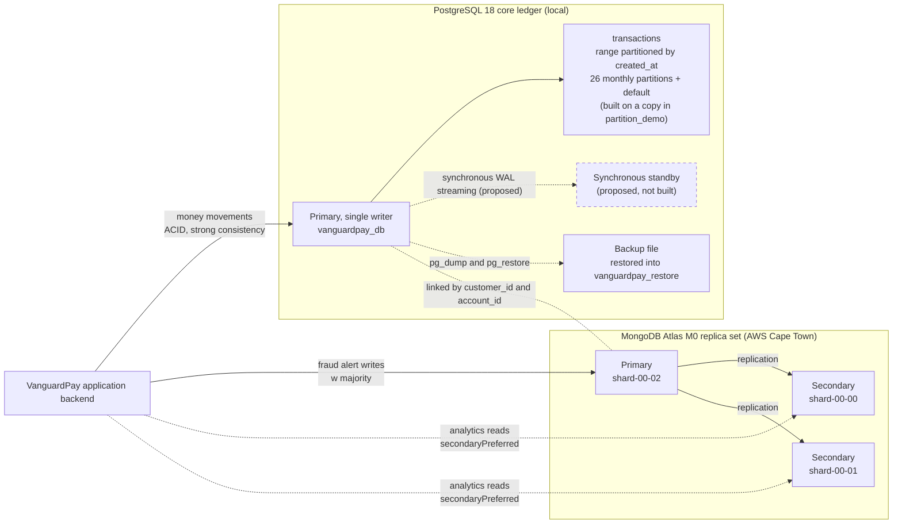

MongoDB has no foreign keys, so the application enforces the `customer_id` and `account_id` links between the two systems, as documented in Portfolio 4.

---

## Stage 1: PostgreSQL 18 Partitioning, Replication and Recovery

### 1.1 Range Partitioning on a Copy of `transactions`

I partitioned a copy of the ledger instead of the live table. A partitioned table's primary key must include the partition column, so the key becomes `(transaction_id, created_at)`. The foreign key from `transaction_logs` points at `transaction_id` alone, so partitioning `public.transactions` would have broken Portfolios 1 to 3. I built `partition_demo.transactions` in a separate schema and left the live ledger untouched.

In `partitioning.sql`, I:

- created the table with `PARTITION BY RANGE (created_at)`, with the same `CHECK` constraints and foreign keys to `public.accounts`;
- wrote a `DO` block that reads the earliest and latest `created_at` and creates one monthly partition for every month in between, so no date is hard-coded;
- added a default partition for any row outside the monthly ranges;
- loaded all rows from `public.transactions` and ran `ANALYZE`.

The ledger spans about two years. Step 1 of the script returned an earliest date of `2024-10-26` and a latest of `2026-10-30`, because the seed script dates each opening deposit just after its account opened. The `DO` block created 26 monthly partitions, from `transactions_2024_10` to `transactions_2026_11`, plus `transactions_default`.

| Check | `public.transactions` | `partition_demo.transactions` |
|---|---|---|
| Row count | 20,012 | 20,012 |
| Total amount (NGN) | 2,969,904,160.00 | 2,969,904,160.00 |
| Rows in the default partition | not applicable | 0 |

All 20,012 rows landed in monthly partitions. The early months hold 1 to 68 rows each, because they contain only opening deposits. February 2026 holds 331 rows, and March to October 2026 hold between 2,024 and 2,457 rows each. November 2026 and the default partition are empty.

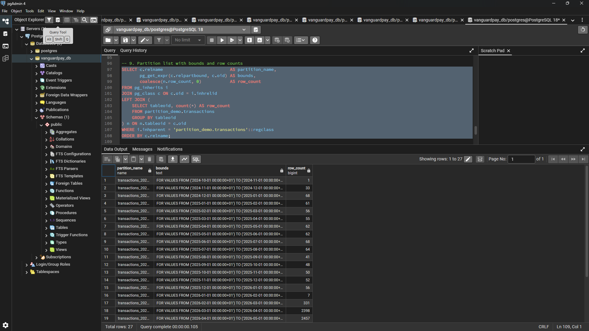

*Figure 1: The 27 partitions of `partition_demo.transactions`, with their bounds and row counts. The default partition holds 0 rows.*

### 1.2 Partition Pruning with `EXPLAIN (ANALYZE, BUFFERS)`

I ran the same aggregate, `count(*)` and `sum(amount)`, twice. The first query filtered on October 2026, and the second had no date filter.

| Measure | One-month filter | No filter |
|---|---|---|
| Partitions read | 1 of 27 | 27 of 27 |
| Rows read by the scan | 2,024 | 20,012 |
| Shared buffer hits | 28 | 282 |
| Execution time | 0.459 ms | 4.718 ms |
| Planning time | 0.381 ms | 0.919 ms |

With the date filter, the plan scanned only `transactions_2026_10` and skipped the other 26 partitions. Buffer hits and execution time both fell by about 10 times. The buffer-hit reduction follows directly from the number of partitions read and scales with table size, while the execution times reflect a dataset of 20,012 rows.

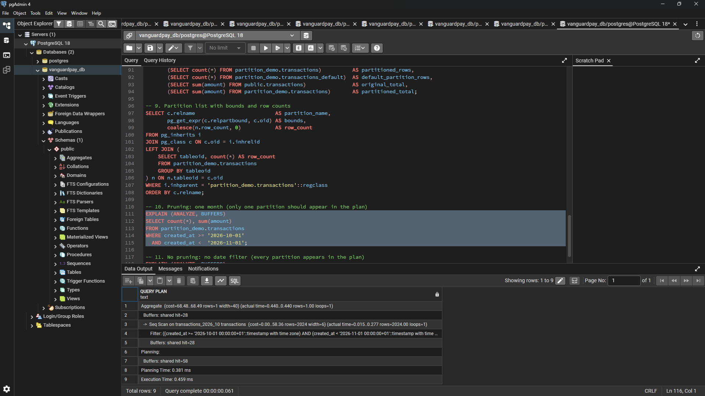

*Figure 2: The filtered plan scans one partition (28 buffer hits), and the unfiltered plan appends all 27 (282 buffer hits).*

### 1.3 Replication Catalog Check

I ran section 1 of `replication_and_backup_checks.sql` to read the replication configuration and WAL status of the server.

| Check | Value | What it means |
|---|---|---|
| `server_version` | 18.6 | The PostgreSQL version |
| `is_standby` | false | This server is a primary |
| `wal_level` | replica | The write-ahead log carries enough detail for physical streaming replication |
| `max_wal_senders` | 10 | Up to 10 standby or backup connections can stream the log |
| `max_replication_slots` | 10 | Up to 10 replication slots can be created |
| `replication_slots` | 0 | No slot exists yet |
| `connected_standbys` | 0 | Nothing is streaming from this server |
| `hot_standby` | on | A standby built from this configuration could answer read-only queries |
| `synchronous_commit` | on | A commit waits for its log to be flushed, and for any named synchronous standby |
| `synchronous_standby_names` | empty | No synchronous standby is named |
| `archive_mode` | off | Finished log files are not archived, so point-in-time recovery is not possible |
| `current_wal_lsn` | 0/3507830 | The current write position in the log, in file `000000010000000000000003` |

The server is a primary configured to stream WAL, with no standby attached and WAL archiving disabled. Recovery therefore relies on the logical backup in section 1.4.

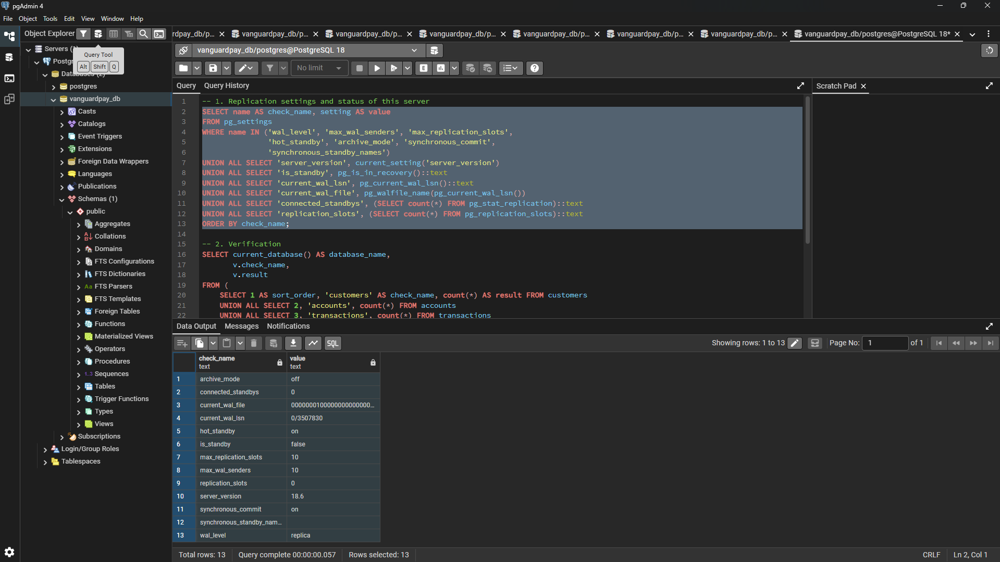

*Figure 3: Replication settings and WAL status of the PostgreSQL 18.6 server. `connected_standbys` and `replication_slots` are both 0.*

### 1.4 Backup and Restore Verification

I backed up `vanguardpay_db` with `pg_dump` in Custom format (`vanguardpay_p5.backup`) and restored the file with `pg_restore` into an empty database named `vanguardpay_restore`. I then ran the same verification query on both databases.

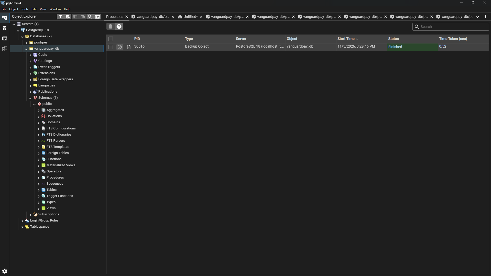

*Figure 4: The pgAdmin process log after the `pg_dump` backup of `vanguardpay_db` completed.*

| Check | `vanguardpay_db` | `vanguardpay_restore` | Match |
|---|---|---|---|
| `customers` | 500 | 500 | Yes |
| `accounts` | 800 | 800 | Yes |
| `transactions` | 20,012 | 20,012 | Yes |
| `transaction_logs` | 27,727 | 27,727 | Yes |
| `beneficiaries` | 1,406 | 1,406 | Yes |
| `partition_demo_transactions` | 20,012 | 20,012 | Yes |
| `total_balance_ngn` | 952,708,440.00 | 952,708,440.00 | Yes |
| `accounts_checked` | 800 | 800 | Yes |
| `accounts_out_of_balance` | 0 | 0 | Yes |

Every count and the total balance match, and the balance audit from Key Operation 6 finds 0 of 800 accounts out of balance in the restored copy. The `partition_demo` schema and the `v_balance_audit` view were restored too, because the verification query reads both.

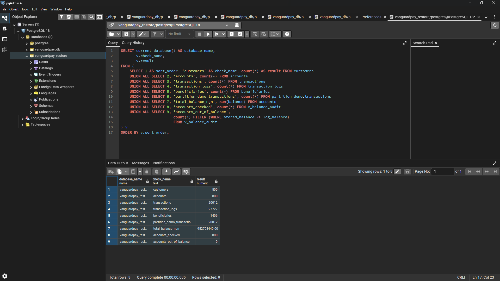

*Figure 5: The verification query run on `vanguardpay_restore`. All nine results match the original.*

### Results

- Range partitioning placed all 20,012 rows in monthly partitions, left the default partition empty, and matched the live ledger on row count and total amount.
- A one-month query read 1 of 27 partitions, which cut buffer hits from 282 to 28 and execution time from 4.718 ms to 0.459 ms.
- The server is a primary with `wal_level = replica`, 0 connected standbys, and `archive_mode = off`.
- The restored database matched the original on all nine checks, with 0 of 800 accounts out of balance.

---

## Stage 2: MongoDB Atlas Replica Set

### 2.1 Cluster and Replica Set Topology

The Atlas cluster is a 3-node replica set.

| Item | Value |
|---|---|
| Version | 8.0.36 |
| Region | AWS / Cape Town (`af-south-1`) |
| Type | Replica Set - 3 nodes |
| Disaster Recovery | Backups Inactive |

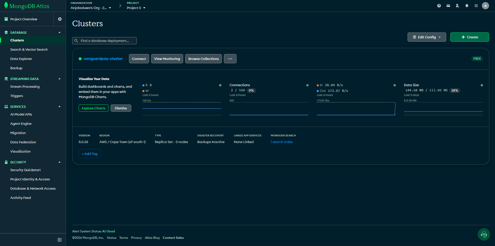

*Figure 6: The Atlas cluster card. It shows a 3-node replica set in one region, with backups inactive.*

I ran `db.hello()` in the `mongosh` shell to read the topology.

| Node | Role |
|---|---|
| `ac-kpnm5qz-shard-00-02...:27017` | Primary (the node the shell connected to) |
| `ac-kpnm5qz-shard-00-00...:27017` | Secondary |
| `ac-kpnm5qz-shard-00-01...:27017` | Secondary |

The replica set is named `atlas-hm4jvp-shard-0`, and `is_writable_primary` was `true` on the connected node. One primary takes the writes and two secondaries replicate them.

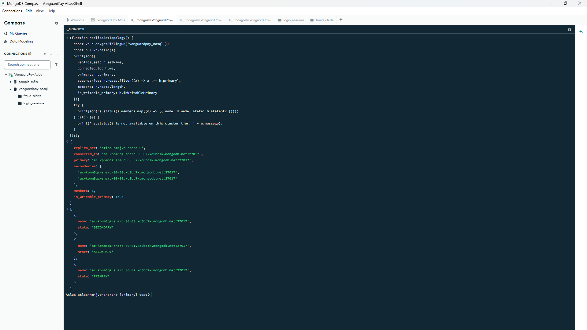

*Figure 7: The replica set name, the primary and the two secondaries from `db.hello()`.*

### 2.2 Write Concern

I inserted 20 documents into a test collection under each write concern setting, and then sent one write that requested more confirmations than the cluster has nodes.

| Test | Write concern | Inserts | Acknowledged | Total time | Average per insert |
|---|---|---|---|---|---|
| `w_1` | `{ w: 1 }` | 20 | 20 | 2,111 ms | 105.6 ms |
| `w_majority` | `{ w: "majority" }` | 20 | 20 | 2,187 ms | 109.4 ms |
| `w_3_all_nodes` | `{ w: 3 }` | 20 | 20 | 2,315 ms | 115.8 ms |

Each stronger setting added a few milliseconds over the `105.6 ms` network baseline between Lagos and the Cape Town cluster: `3.8 ms` per insert for `"majority"` and `10.2 ms` for all three nodes.

For the `w: 4` test, I used `{ w: 4, wtimeout: 5000 }`, which requests one more acknowledgement than the three data-bearing nodes can provide.

| Result | Value |
|---|---|
| Error type | `MongoWriteConcernError` |
| Code | 100 (`UnsatisfiableWriteConcern`) |
| Message | Not enough data-bearing nodes |
| `w_4_impossible` documents stored afterwards | 1 |

The server refused to report success for a guarantee it could not meet, but it did not undo the write: the document was still on the primary when I read it back. A failed write concern in MongoDB tells the client that replication acknowledgement failed without rolling back the primary write, whereas a failed transaction in PostgreSQL rolls back completely, as shown in Portfolio 3.

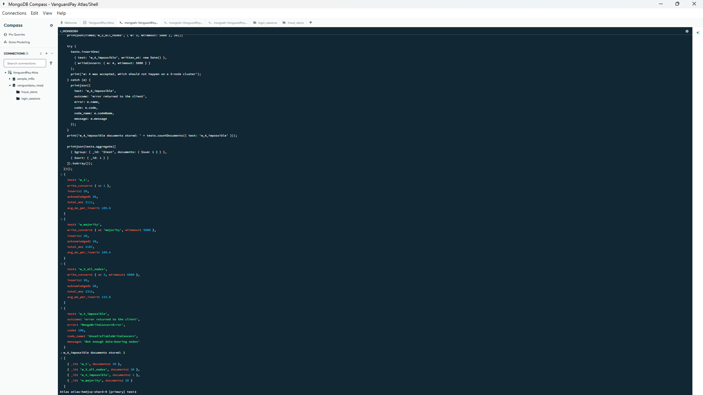

*Figure 8: Timings for `w: 1`, `"majority"` and `w: 3`, then the `w: 4` error and the per-test document counts.*

### 2.3 Read Preference

I ran `explain('executionStats')` on an open-alerts query against `fraud_alerts` under `primary`, `secondaryPreferred`, and `secondary` read preferences and recorded the answering node from `serverInfo`.

| Read preference | Node that answered | Role |
|---|---|---|
| `primary` | `ac-kpnm5qz-shard-00-02...` | Primary |
| `secondaryPreferred` | `ac-kpnm5qz-shard-00-01...` | Secondary |
| `secondary` | `ac-kpnm5qz-shard-00-00...` | Secondary |

The `secondary` read left the primary. Ten `secondaryPreferred` reads split evenly, 5 on `shard-00-00` and 5 on `shard-00-01`, distributing read load across both copies.

Because secondary replication is asynchronous, a secondary can lag behind the primary. I tested this with a 20-iteration stale-read probe that wrote one document with `w: 1` and immediately read it back from a secondary. All 20 reads found the document (`0` stale reads). While replication lag within the Cape Town region was smaller than the client round-trip time during this run, secondary reads remain eventually consistent.

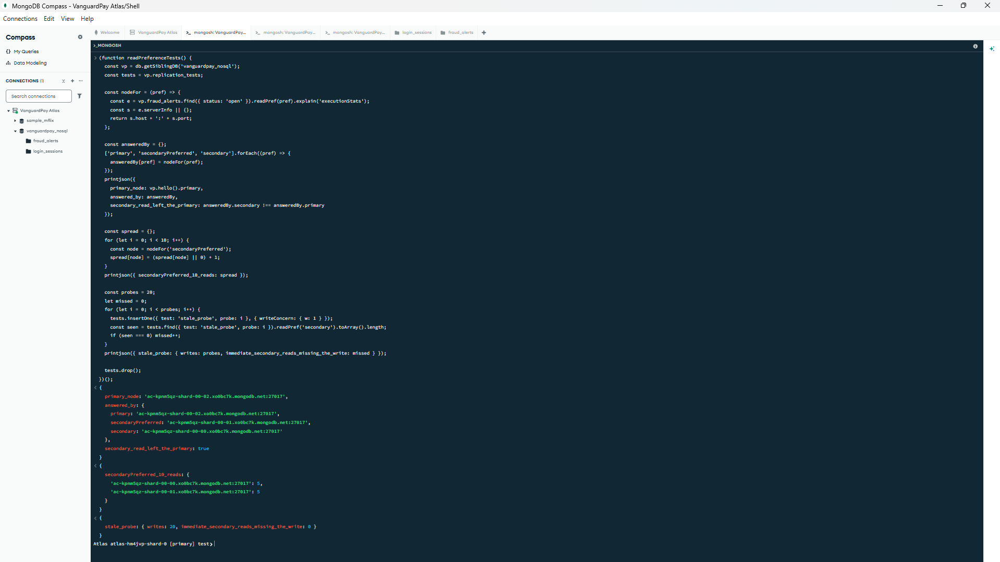

*Figure 9: The node that answered under each read preference, the 5/5 split across the secondaries, and the stale-read probe result of 0 of 20.*

### 2.4 Logical Collection Backup and Restore

With automated cluster backups inactive on M0, I exported `fraud_alerts` as an Extended JSON archive (`fraud_alerts_backup.json`) and imported it into `fraud_alerts_restore_test`. Block 4 of `replica_set_tests.js` compared both collections, verifying document counts, BSON `Date` preservation on `created_at`, and alert totals by `rule_type`. I dropped the test collection after the check.

| Check | `fraud_alerts` | `fraud_alerts_restore_test` |
|---|---|---|
| Documents | 153 | 153 |
| `created_at` stored as a date | 153 | 153 |
| `device_mismatch` alerts | 43 | 43 |
| `failed_login_streak` alerts | 48 | 48 |
| `impossible_travel` alerts | 52 | 52 |
| `transfer_burst` alerts | 10 | 10 |

The script printed `Restored copy matches the original: true`.

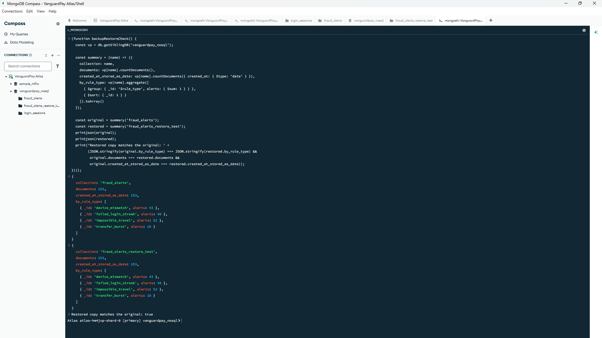

*Figure 10: Block 4 compares `fraud_alerts` with the restored test collection. Counts, date types and rule-type totals all match.*

### Results

- The Atlas cluster is a 3-node replica set (`atlas-hm4jvp-shard-0`) with one primary and two secondaries.
- Inserts under `w: 1`, `"majority"` and `w: 3` were all acknowledged, with averages of 105.6, 109.4 and 115.8 ms. The `w: 4` write failed with `UnsatisfiableWriteConcern` (code 100), and its document was still stored.
- A `secondary` read was answered by a different node from the `primary`, `secondaryPreferred` reads split 5 and 5 across the two secondaries, and 0 of 20 immediate secondary reads missed a fresh write.
- The restored `fraud_alerts` copy matched the original on 153 documents, 153 date values, and all four rule-type totals.

---

## Architectural Design and Justification

### CAP Theorem

Under a network partition between nodes, VanguardPay makes a workload-specific choice between consistency (CP) and availability (AP):

| Component | Choice | Behaviour when the network splits |
|---|---|---|
| PostgreSQL ledger with a synchronous standby quorum | Consistency (CP) | A commit waits for a standby, so writes stall instead of the copies diverging |
| MongoDB `fraud_alerts` writes with `w: "majority"` | Consistency (CP) | Only the side holding a majority of nodes can elect a primary and accept majority-acknowledged writes |
| MongoDB analytics reads with `secondaryPreferred` | Availability, eventual consistency | A secondary answers even if it is slightly behind the primary |

**PostgreSQL ledger.** A wrong balance is worse than a short delay, so the ledger chooses consistency. On one node, `ACID` transactions provide it, as shown in Portfolio 3. A synchronous standby extends the same guarantee across servers, because a commit is only reported once a standby has flushed the WAL. Because a single synchronous standby would stall every write if it went offline, the design uses a quorum of two standbys:

```ini
# postgresql.conf on the primary
synchronous_commit = on
synchronous_standby_names = 'ANY 1 (standby_a, standby_b)'
```

With `ANY 1`, each acknowledged commit exists on at least one standby, and either standby can fail without stopping the ledger.

**MongoDB fraud alerts.** Fraud alert writes use `w: "majority"`, set explicitly in the application, so an acknowledged alert exists on at least two of the three nodes and survives the loss of one. The `w: 4` test confirmed that the server enforces the requested acknowledgement count and refuses to report a guarantee it cannot meet.

**MongoDB analytics reads.** For reads such as failed logins per country, a slightly delayed count is acceptable and offloading queries to secondaries reduces load on the primary. Balance decisions never use `secondaryPreferred` and stay in PostgreSQL.

### Sharding and Partitioning Design

**PostgreSQL: range partitioning on `created_at`.** Most `transactions` queries are date-bound. Account statements (Key Operation 7), balance audits and fraud checks all ask for a time window, and the pruning test showed a one-month query reading 1 of 27 partitions. Old months can also be detached or archived independently. The trade-offs are:

- the primary key must include `created_at`;
- PostgreSQL cannot enforce `reference` as unique across all partitions;
- `transaction_logs` would need `created_at` in a composite foreign key to reference a partitioned table;
- each future month needs its partition created before rows arrive, or those rows land in the default partition.

Partitioning splits a table inside one server. It reduces query cost, but it does not distribute load across servers.

**MongoDB: compound shard keys.** For horizontal scaling across multiple shards in a dedicated Atlas cluster (M30+), each collection uses a compound shard key:

| Collection | Shard key | Reason |
|---|---|---|
| `login_sessions` | `{ customer_id: 1, login_at: 1 }` | Customer-scoped queries, like the sessions-for-one-customer query in Portfolio 4, route to one shard |
| `fraud_alerts` | `{ customer_id: 1, created_at: 1 }` | Co-locates customer alerts by `customer_id`, using `created_at` as the time suffix |

The reasoning for the keys:

- **`customer_id` first** spreads inserts across customers and lets customer-scoped queries target a single shard.
- **A time field second** matters because the dataset has 500 distinct customers; an active customer could otherwise grow a chunk that cannot be split, and the timestamp provides fine-grained split points.
- **A time field alone** would be a poor key, because new documents always carry the newest timestamp and would create a write hotspot on one shard.

The trade-offs:

- queries without `customer_id`, such as failed logins per country or alerts by rule type, become scatter-gather queries across every shard;
- unique indexes on `session_id` and `alert_id` cannot be enforced across shards unless prefixed by the shard key, so the application must enforce those identifiers.

### High Availability and Failover

| Situation | PostgreSQL ledger | MongoDB Atlas |
|---|---|---|
| Primary fails | The standby is promoted with `pg_promote()` via an orchestrator such as Patroni or `repmgr`. With synchronous commit, every acknowledged commit exists on at least one standby. | The two secondaries hold an election and one becomes primary (typically within ~10 seconds without a heartbeat from the primary). |
| One standby or secondary fails | The `ANY 1` quorum keeps commits flowing while the other standby is up. | The replica set keeps a majority of 2 out of 3, so `w: "majority"` writes continue. |
| Whole region fails | A standby in a second region maintains an off-site copy of the ledger. | A multi-region replica set distributes voting members across regions so a majority survives. |
| Data loss or corruption | `archive_mode = on` with WAL archiving and regular base backups gives point-in-time recovery on top of `pg_dump` backups. | Extended JSON exports back up individual collections, supplemented by scheduled Atlas cloud snapshots on dedicated tiers. |

The two systems recover differently. PostgreSQL requires orchestrated standby promotion (`Patroni` / `pg_promote()`) and loses zero committed transactions under synchronous quorum replication, whereas MongoDB elects a new primary automatically during a brief pause in writes.

---

## Technical Reflection

### Key Insights and Trade-offs

- **Durability against latency:** In the 20-insert test, `w: "majority"` added `3.8 ms` and `w: 3` added `10.2 ms` per insert over `w: 1`. For fraud alerts, `w: "majority"` is a small latency cost for a guarantee that survives the loss of a node.
- **Write concern failure against rollback:** The `w: 4` write returned `UnsatisfiableWriteConcern` (code 100), but the document was still stored on the primary. PostgreSQL rolls back a failed transaction completely, whereas MongoDB leaves the primary write in place, requiring the application to reconcile write-concern errors. This reinforces keeping money movements in PostgreSQL.
- **Partitioning against integrity constraints:** Pruning cut buffer hits from 282 to 28, but the primary key had to include `created_at`, `reference` could no longer be unique across the table, and the foreign key from `transaction_logs` could not point at `transaction_id` alone. Partitioning a copy in `partition_demo` kept Portfolios 1 to 3 intact and exposed the trade-off.
- **Partitioning against sharding:** Partitions live on one server. They reduce query work, but they provide no protection against server failure (which requires a standby) and no horizontal write scaling (which requires sharding).
- **Partition boundaries from the data:** Generating monthly partitions dynamically from `min(created_at)` and `max(created_at)` placed all 20,012 rows in monthly partitions and left `transactions_default` at 0. A fixed list of recent months would have routed the earlier opening deposits into the default partition.
- **Eventual consistency on secondary reads:** `secondaryPreferred` distributed reads evenly (`5` and `5`) and showed 0 stale reads across 20 probes, but low empirical lag does not guarantee linearisability. Reads that feed a balance decision stay on PostgreSQL.
- **Shard key design:** A compound key with `customer_id` first keeps customer queries on one shard and avoids a monotonic timestamp hotspot, at the cost of scatter-gather execution on cross-customer aggregations.
- **Backup verification:** Checking the restored copy is what validates a backup. The nine-check comparison and `v_balance_audit` (`0` of `800` out of balance) validated `vanguardpay_restore`, and the BSON date-type check validated the Extended JSON restore of `fraud_alerts`.

---

## AI Use Declaration

**AI tool used:** Claude (Anthropic).

**What I used it for:** I used Claude as a learning partner. It clarified replication, partitioning, write concern, read preference and the CAP theorem, and it assisted with SQL and `mongosh` scripting, troubleshooting, and drafting the documentation.

**How I reviewed, corrected, tested and verified the output:** I ran every script myself, using pgAdmin 4 for `partitioning.sql` and `replication_and_backup_checks.sql` and MongoDB Compass for `replica_set_tests.js`, and I took all 10 screenshots from my own runs. I copied every number, node name and error message into this README from my own output. I checked the results against each other, for example that the partitioned copy matches the live ledger on row count and total amount (20,012 rows and `2,969,904,160.00`), that the restored database matches the original on all nine checks, and that the restored `fraud_alerts` copy matches on 153 documents and 153 date values. I used the balance audit to confirm that no account was out of balance after the restore. I partitioned a copy in `partition_demo` so that the live ledger from Portfolios 1 to 3 stays unchanged.

I remain responsible for the accuracy, originality and understanding of everything in this portfolio.                                    
